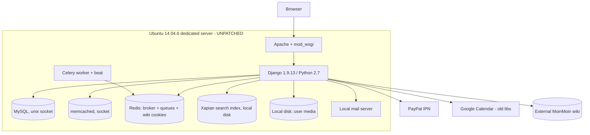
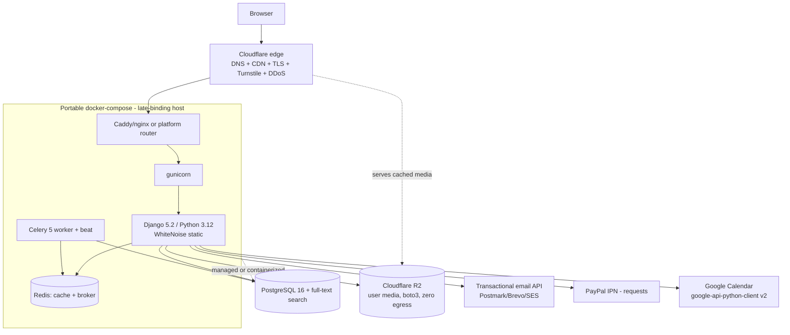

# Detailed Design: Modernizing SG101

**Project:** Modernizing SG101 (Surf Guitar 101 community site)
**Date:** 2026-07-04 · **Branch:** hg `modernize` (to become git)
**Status:** Design for review

> This document is standalone. It consolidates the requirements
> (`idea-honing.md`) and research (`research/*.md`) into an actionable design. It
> is the single reference needed to build the implementation plan.

---

## 1. Overview

SG101 is a Django community site (forums, news, downloads, podcasts, photos,
donations, event calendar, and more) currently running **Django 1.9.13 on Python
2.7**, on an unpatched **Ubuntu 14.04.6** dedicated server, with a Python-2-era
dependency stack and MySQL. This project modernizes it to a **supported,
secure, maintainable stack** — **latest Django LTS (5.2) on Python 3.12** — and
**re-homes it off the aging dedicated server**, while **pruning** dead or
expensive-to-port legacy. No new user-facing features are in scope.

**Guiding strategy (the through-line):**
1. **Containerize the legacy stack** so it can run and be tested on a modern Mac
   (Python 2.7 can no longer run natively there).
2. **Grow risk-based test coverage** and stand up **CI**, using real production
   data snapshots.
3. **Climb the Django LTS ladder** one rung at a time in Docker, switching to
   Python 3 at the Django 1.11→2.x boundary; clear deprecations each rung.
4. **Prune and modernize subsystems** (search, DB, media, email, secrets) at the
   right rungs.
5. **Deploy to a new modern host once, at the end**, keeping the old box as
   fallback. Provider choice is **late-binding** (portable containers).

**Key principle:** never change two big variables at once; every rung ends in a
**working, shippable, demoable** increment.

---

## 2. Detailed Requirements (consolidated)

### 2.1 Scope
- **R1 — Lift + prune.** Modernize the stack; remove dead/expensive legacy where
  porting isn't worth it. **No new features**, no broad UX/architecture refresh.

### 2.2 Target end-state
- **R2 — Django:** land on **5.2 LTS** (supported to Apr 2028). *(4.2 LTS reached
  EOL Apr 2026 → pass-through only, not a resting point.)*
- **R3 — Python:** **3.12** (within 5.2's 3.10–3.14 support window).
- **R4 — Laddered upgrade with safe LTS resting points:**
  `1.9 → 1.11 → 2.2 → 3.2 → 5.2` (4.2 traversed en route). **Python 3 switch on
  Django 1.11** (last version supporting both Py2 and Py3).
- **R5 — Resumable:** solo developer, weekend-burst cadence → steps must be small
  and checkpointable; site always shippable at a rung.

### 2.3 Testing & CI
- **R6 — Risk-based coverage:** thorough on critical paths (auth, forums,
  donations/PayPal, comments, messages, media/S3, search replacement); lower on
  peripheral apps. Measure current coverage first.
- **R7 — Integration/functional-first** (Django test client on real URLs), unit
  tests backfilling tricky logic.
- **R8 — CI on GitHub Actions**, warnings-as-errors for deprecations, test on the
  real DB engine (Postgres/Redis service containers).
- **R9 — Per-rung acceptance:** suite passes on the new Django/Python **and** a
  short **manual smoke checklist** (login, forum post, photo upload, search,
  donation, admin); clear all deprecation warnings before the next jump.

### 2.4 Dev environment
- **R10 — Dockerized legacy stack** (Py2.7 + Django 1.9 + MySQL + Redis) as the
  enabling first step; well-commented (user is new to Docker); faithful
  reproduction first, vendor/pin only if needed.
- **R11 — Real data:** load production DB snapshots (readily available) for
  realistic testing.
- **R12 — Dev/prod parity:** build the container for production use from day one
  (12-factor, env-driven), so deploy-at-end is not a separate scramble.

### 2.5 Version control & repo
- **R13 — hg → git** preserving branch history (incl. `modernize`); **public
  GitHub**; vendor private deps (`queues`; reuse existing `django-elsewhere`
  fork). Secret-history audit before going public.

### 2.6 Sequencing & hosting
- **R14 — Modernize locally first, deploy once at the end.** No second server
  during iteration. Old Ubuntu 14.04 box left running (accepted low-traffic
  risk). Option to cut over at an intermediate rung retained.
- **R15 — Cutover:** short maintenance window acceptable; keep old box warm as
  fallback ~1–2 weeks. No zero-downtime data sync required.
- **R16 — Hosting late-binding:** portable docker-compose; provider TBD near
  deploy (candidates: single VM on Linode/Lightsail (preferred), Render,
  Lightsail+RDS). **AWS allowed if kept simple** (Lightsail, not ECS/EKS/App-
  Runner-only). **Cloudflare (already in use) fronts the origin** — DNS, CDN,
  edge TLS, DDoS, Turnstile — simplifying the origin and easing the DNS cutover;
  this complements any chosen origin shape.

### 2.7 Data, DB & subsystems
- **R17 — Database:** decide MySQL→**PostgreSQL** after inspecting a snapshot
  (decision made early); **lean Postgres** (unlocks Postgres FTS, simpler
  hosting). Engine switch is its own deliberate step, **positioned mid-ladder:
  right after Django 3.2 LTS on Python 3** (not an early step; not deferred to the
  end). Fallback: stay on MySQL 8.
- **R18 — Search:** live in production (Haystack/Xapian). Handled as **two
  separable actions**: (a) **remove the already-disabled search stack early**
  (Xapian/Haystack/`queued_search`/`queues`/`custom_search` + dead code) so the
  native/private deps never need Python-3 porting — search stays stubbed during
  the climb; (b) **build the replacement when Postgres arrives (step G)**.
  **Decision (Postgres FTS vs. port Xapian) made early from the snapshot**;
  working hypothesis = **Postgres full-text search** (cures the "can't run Xapian"
  pain; removes the persistent-disk hosting constraint). Must reach parity before
  cutover.
- **R19 — Media:** return user uploads to **S3-compatible object storage** via
  `boto3`; modern Python fixes the old TLS problem that forced local storage.
  **Preferred: Cloudflare R2** (zero egress — ideal for an image-serving
  community site; $0.015/GB, 10 GB free; same boto3 code via custom
  `endpoint_url`). Alternatives: Linode Object Storage, AWS S3.
- **R20 — Email:** replace the local mail server with a **transactional email
  provider** (Postmark/Brevo/SES) for deliverability from a fresh host.
  *(Note: Cloudflare Email Routing is inbound-only — it does NOT send outbound
  transactional mail, so a provider is still required.)*
- **R21 — Cache/broker:** **consolidate memcached into Redis** (cache + Celery
  broker); drop memcached.
- **R22 — Secrets:** replace `secrets.json` with **environment variables**
  (12-factor — config read from `os.environ`, not a file; safe for a public repo,
  universal across Docker/hosts); committed `.env.example`; rotate anything exposed.
- **R23 — CAPTCHA:** **migrate reCAPTCHA → Cloudflare Turnstile** (free,
  unlimited, privacy-preserving; official reCAPTCHA migration guide). Timely
  because reCAPTCHA moved to Enterprise with a 10k/mo free cap then paid.
  (Fallback: keep reCAPTCHA.)
- **R24 — Donations:** keep PayPal IPN; port `urllib2`→`requests`; verify IPN is
  still supported by PayPal (legacy API).

### 2.8 App triage
- **R25 — Prune:** `irc` (unused), `legacy` (one-off phpBB importers).
- **R26 — Retire candidate:** `wiki` app + external **MoinMoin** bridge (user open
  to retiring; archive content first).
- **R27 — Revive:** `gcalendar` with modern Google client libs (`google-api-
  python-client` v2 + `google-auth`).
- **R28 — Verify then keep/prune:** `contests`, `banners`, `membermap`, `oembed`
  (confirm usage against snapshot). Default keep.
- **R29 — Keep:** all core apps (forums, accounts, news, downloads, bio,
  weblinks, podcast, potd, polls, messages, comments, donations, core, bandmap,
  shoutbox, smiley, user_photos, antispam, ygroup, countdown, bulletins).

---

## 3. Architecture Overview

### 3.1 Current (production) state

### 3.2 Target state

Removed vs. current: memcached, Xapian/Haystack/queued_search/`queues`, local
media disk, local mail server, `irc`, `legacy`, (candidate) `wiki`/MoinMoin,
Apache/mod_wsgi → gunicorn. **Cloudflare** (already used by the site) fronts the
origin for DNS, CDN caching, edge TLS, DDoS protection, and **Turnstile** CAPTCHA;
**R2** (S3-compatible, zero-egress) holds user media. Cloudflare in front also
makes the **DNS cutover** a fast, low-TTL flip and lets the origin stay simple.

### 3.3 Migration trajectory (how we get there)

```mermaid
flowchart LR
    A[Dockerize legacy<br/>Py2.7 + Django 1.9] --> B[hg→git + CI + coverage baseline<br/>+ snapshot: decide Postgres vs Xapian]
    B --> B2[Drop already-disabled search deps<br/>Xapian/Haystack/queued_search/queues]
    B2 --> C[Django 1.11<br/>+ make Py2/3 compatible]
    C --> D[Flip interpreter → Py3<br/>still Django 1.11]
    D --> E[Django 2.2]
    E --> F[Django 3.2 LTS]
    F --> G[MySQL → PostgreSQL<br/>+ build Postgres FTS search<br/>on Python 3 / modern LTS]
    G --> H[Django 4.2 → 5.2 LTS<br/>on Postgres]
    H --> I[Media→R2, email→provider,<br/>boto3, gcalendar revive, Turnstile]
    I --> J[Prod compose hardening<br/>+ Cloudflare in front]
    J --> K[Deploy to new host<br/>+ DNS cutover + fallback]
```

*(Sequencing rationale — two separable concerns: **(1) removing the old search
stack** happens **early** (B2): it is already disabled on the branch, so we drop
Xapian/Haystack/`queued_search`/`queues`/`custom_search` and their dead code up
front so the native/private deps never need Python-3 porting; search stays
stubbed during the climb. **(2) Building the Postgres FTS replacement** happens
with the **MySQL→Postgres migration (step G), positioned in the middle — right
after Django 3.2 LTS on Python 3** — not an early step, but not deferred to the
end either. This means the fragile deps leave early, the engine swap runs on a
stable modern Py3 LTS decoupled from the Py2→Py3 flip, and rungs 3.2→5.2 are
tested on the real target engine. The **Postgres-vs-Xapian decision** is made
early from the DB snapshot (step B); only the execution lands at G.)*

---

## 4. Components and Interfaces (modernization workstreams)

Each is a subsystem of work with clear inputs/outputs and a "done" bar.

### C1. Containerized dev environment (enabler)
- **Deliver:** `Dockerfile` (evolving base Python), `docker-compose.yml` +
  `docker-compose.override.yml` (dev), services: web, worker, beat, db, redis.
- **Interface:** `make`/compose commands to build, run, test, load a snapshot.
- **Config:** env vars replace `secrets.json` and `platform.node()` role logic.
- **Done:** legacy app boots in-container against a loaded snapshot; suite runs.

### C2. Version control & CI
- **Deliver:** git repo (history-preserved), public GitHub, `.gitignore`,
  GitHub Actions workflow (test matrix, Postgres/Redis services, coverage,
  warnings-as-errors), vendored private deps.
- **Interface:** every push/PR runs the suite at the current rung.
- **Done:** green CI on the current rung; secret-history audit clean/rotated.

### C3. Test coverage growth
- **Deliver:** coverage baseline report; new integration/functional tests on
  critical paths; unit tests for tricky logic.
- **Interface:** `coverage run manage.py test`; CI coverage gate (risk-based).
- **Done:** critical paths covered enough to trust upgrades (see Testing Strategy).

### C4. Django/Python upgrade ladder
- **Deliver:** per-rung branches/commits; deprecation-clean code; dependency
  bumps required by each rung; the Py2→Py3 compatibility pass on Django 1.11.
- **Interface:** `requirements.txt` per rung; settings modernized
  (`MIDDLEWARE`, `path()`/`re_path()`, class-based auth views, etc.).
- **Done:** each rung: suite green + smoke checklist + no deprecation warnings.

### C5. Database migration (MySQL → PostgreSQL)
- **Deliver:** snapshot analysis; `pgloader` conversion; Postgres settings
  (**`psycopg2`** — Django 3.2 requires it; psycopg 3 needs Django 4.2, so it's a
  Step 13 candidate); data-integrity verification.
- **Interface:** compose `db` service switches engine; Django migrations run on PG.
- **Done:** suite green on Postgres; row counts/data verified vs. MySQL snapshot.

### C6. Search replacement (Postgres FTS) — hypothesis, post-snapshot decision
- **Deliver:** `SearchVectorField` + GIN indexes on the 7 content types; search
  view/UI; index-maintenance (signals or periodic Celery job); deletion of
  Haystack/Xapian/queued_search/`queues`/`custom_search`/`search_indexes.py`.
- **Interface:** `/search/` and `/search/ajax/` restored to real functionality.
- **Done:** search parity vs. documented current behavior; runs with no native libs.

### C7. Media → object storage (Cloudflare R2)
- **Deliver:** `core/s3.py` rewritten for `boto3` (or `django-storages`) pointed
  at **R2** via custom `endpoint_url`; `USER_PHOTOS_*` config to the bucket;
  bulk-migrate existing local files to R2; optional CF-cached public domain for
  media.
- **Interface:** uploads/serves via S3-compatible storage; `USER_IMAGES_SOURCES`
  updated to include the media domain.
- **Done:** upload/display works against R2 in a modern-Python container;
  zero-egress serving via Cloudflare.

### C8. Email → transactional provider
- **Deliver:** Django email backend pointed at provider (SMTP/API); domain +
  SPF/DKIM/DMARC; `DEFAULT_FROM_EMAIL`/error-mail wiring.
- **Done:** registration/notification/admin-error emails deliver to inbox in staging.

### C9. Subsystem consolidation & pruning
- **Deliver:** memcached→Redis cache (`django-redis`); reCAPTCHA→**Turnstile**
  (`antispam` app + forms); remove `irc`, `legacy`; retire `wiki`/MoinMoin
  (archive first, pending decision); revive `gcalendar`; verify-then-decide
  `contests`/`banners`/`membermap`/`oembed`; PayPal IPN `urllib2`→`requests`;
  drop `pycrypto`, `six`, `simplejson`.
- **Done:** removed apps gone from INSTALLED_APPS/urls/migrations cleanly; kept
  apps green.

### C10. Production hardening & deployment
- **Deliver:** prod compose (gunicorn, WhiteNoise/CDN, Postgres, Redis, TLS),
  backups (`pg_dump`→object storage), health checks, provider selection (late).
- **Interface:** `docker compose -f prod` deploy; DNS cutover; old box fallback.
- **Done:** new host serves a fresh snapshot; smoke checklist passes; cutover plan
  ready.

---

## 5. Data Models & Data Concerns

This is a modernization, so "data models" means **data migration and integrity**,
not new schema:

- **DB engine port (MySQL→Postgres):** verify on snapshot — table
  charset/collation (**utf8 vs utf8mb4**: check for 4-byte/emoji truncation),
  **case-sensitivity** differences (MySQL CI collations vs. Postgres CS — audit
  uniqueness on usernames/emails/slugs/tags, add `CITEXT`/constraints as needed),
  boolean/tinyint, auto-increment→identity/sequences (reset after load). Tooling:
  **`pgloader`** for bulk, Django `dumpdata`/`loaddata` for verification.
- **Search index data:** Xapian index is derived/disposable; no data migration —
  the Postgres FTS `SearchVectorField`s are (re)built from existing rows.
- **Tagging:** if `django-tagging`→`django-taggit`, a small data migration of
  tag/relationship tables.
- **Picklefield → JSON:** if `django-picklefield` fields are converted to
  `JSONField` (security), a data conversion migration is required.
- **Media files:** bulk-copy existing local user media to the object-storage
  bucket; update any stored paths/URLs.
- **Secrets → env:** move all `SECRETS[...]` keys (SECRET_KEY, DB_*, GCAL_*,
  AWS_*, RECAPTCHA_*) to environment variables; provide `.env.example`.
- **Zero raw SQL** in app code (verified) → ORM portability is high.

---

## 6. Error Handling, Safety & Rollback

- **Per-rung safety (R9):** a rung is "done" only when the suite is green on the
  new Django/Python, all deprecation warnings are cleared, and the manual smoke
  checklist passes. Otherwise, stay on the previous rung (git makes this trivial).
- **Development rollback:** all iteration is local in git; each rung is a
  tagged, shippable checkpoint. Bad step → revert to the last good tag.
- **DB migration safety:** perform on a *copy* of a snapshot; verify row
  counts/spot-check content before trusting; keep the MySQL fallback path (R17)
  until Postgres is proven.
- **Search safety:** production keeps running Xapian on the old box until the
  Postgres FTS replacement reaches documented parity; only then does it ship at
  cutover (R18).
- **Cutover (R14/R15):** short maintenance window; final snapshot → restore to new
  host → DNS switch. **Old box kept warm ~1–2 weeks** as instant DNS-flip
  fallback. Optional intermediate-rung cutover remains available.
- **Deliverability risk:** email moves to a provider *before* cutover and is
  validated in staging to avoid a cutover-day surprise.
- **Secret exposure:** history audit + rotation before the repo goes public.
- **Accepted risk:** the unpatched Ubuntu 14.04 box remains in production during
  the project (low-traffic, eyes-open).

---

## 7. Testing Strategy

- **Baseline first:** measure coverage in the legacy container before upgrading.
- **Risk-based targets (R6):** prioritize forums (posting/permissions/feeds),
  accounts/auth, donations (PayPal IPN — already has good fixture tests),
  comments, messages (purge), user_photos/S3, and the search replacement. Accept
  thinner coverage on peripheral/widget apps.
- **Style (R7):** integration/functional tests via Django's test client hitting
  real URLs (catch upgrade regressions cheaply), unit tests for tricky logic
  (markup, spam checks, IPN verification, permissions).
- **Engine parity:** keep fast sqlite runs for unit tests, but also run the suite
  on **Postgres** (CI service container) once migrated so PG-specific behavior is
  covered — closing the current gap where only sqlite is exercised.
- **Deprecation gate (R8/R9):** run tests with `-W error::DeprecationWarning`;
  the build fails on any deprecation, forcing per-rung cleanup.
- **CI matrix (R8):** pin to the current rung's Django+Python; optionally also run
  the next rung to de-risk the upcoming jump. Postgres + Redis as service
  containers.
- **Manual smoke checklist (R9):** login, post to a forum, upload a photo, run a
  search, make a (test) donation, use the admin — run by the developer each rung
  and at cutover.

---

## 8. Appendices

### 8.1 Technology choices (with rationale)

| Decision | Choice | Why |
|----------|--------|-----|
| Django target | **5.2 LTS** | Latest LTS, supported to Apr 2028; 4.2 is EOL |
| Python target | **3.12** | In 5.2's support window; broadly supported |
| Interpreter switch point | **Django 1.11** | Last version supporting both Py2 & Py3 |
| DB | **PostgreSQL** (lean) | Enables Postgres FTS (deletes Xapian stack), simpler/cheaper managed hosting, best Django support; fallback MySQL 8 |
| Search | **Postgres FTS** (hypothesis) | No native libs, no persistent-disk constraint, big prune; final call post-snapshot |
| Cache/broker | **Redis only** | Fold memcached in; one fewer service |
| Media | **Cloudflare R2** (S3-compatible, boto3) | **Zero egress** (ideal for image-heavy site), $0.015/GB, 10 GB free; same boto3 code via `endpoint_url`. Alts: Linode Object Storage, S3 |
| Email | **Transactional provider** (Postmark/Brevo/SES) | Deliverability from fresh host; removes local-mail headache. (CF Email Routing is inbound-only) |
| CAPTCHA | **Cloudflare Turnstile** | Free/unlimited, privacy-preserving; replaces reCAPTCHA (now Enterprise w/ 10k/mo cap); official migration guide |
| CDN/DNS/TLS/WAF | **Cloudflare** (already in use) | Fronts origin: caching, edge TLS, DDoS, low-TTL DNS cutover; simplifies origin |
| Secrets | **Env vars (12-factor)** | `os.environ` not a file; Docker/prod parity; safe for public repo |
| VCS/CI | **git + public GitHub + Actions** | Free CI, unlimited minutes public, matrix testing |
| Dev env | **Docker + docker-compose** | Only way to run Py2.7 on the Mac; dev/prod parity |
| Deploy | **Portable docker-compose, host late-binding** | Cheapest + flexible; single-VM (Linode/Lightsail) preferred, Render/RDS viable |
| gcalendar | **google-api-python-client v2 + google-auth** | Old apiclient/oauth2client/httplib2 deprecated |

### 8.2 Research findings (summary; see `research/`)
- **Search is live in prod** but disabled on the branch because Xapian won't run
  on a modern laptop — the core argument for replacing it.
- **Py2→Py3 surface is small/concentrated**; **zero raw SQL** → high portability.
- **Concrete breakage** clusters at the 1.11→2.x rung (auth views, url(),
  middleware, urlresolvers).
- **Costs:** Linode *managed* Postgres ~$81/mo (avoid); RDS ~$12–22/mo, Lightsail
  DB $15/mo, Linode Object Storage $5/mo make an affordable, simple stack.
- **`secrets.json` never tracked** (hg-ignored) — lower leak risk; still audit.

### 8.3 Alternative approaches considered
- **Port Xapian forward** instead of Postgres FTS — rejected (native-lib pain,
  persistent-disk constraint, keeps private deps); retained as fallback.
- **Stay on MySQL 8** — acceptable fallback if snapshot shows costly PG migration;
  loses the Postgres FTS prune.
- **Fully-managed PaaS (Render) from the start / rehost-first sequencing** —
  rejected in favor of modernize-locally-then-deploy-once (no 2nd-server cost).
- **Big-bang rewrite / skip intermediate rungs** — rejected; laddered LTS steps
  keep the site shippable and the work resumable.
- **AWS ECS/EKS/App-Runner-only** — rejected as too complex / poor Celery fit;
  Lightsail is the simple-AWS option if AWS is chosen.

### 8.4 Open decision points (resolve during implementation)
1. **Search:** Postgres FTS vs. port Xapian — decide after DB snapshot (R18).
2. **DB:** confirm Postgres vs. stay MySQL — after snapshot (R17).
3. **App verify:** `contests`/`banners`/`membermap`/`oembed` keep vs. prune (R28).
4. **MoinMoin wiki:** retire (archive) vs. keep (R26).
5. **Hosting provider/shape:** pick near deploy (R16); email provider; object-store
   provider.
6. **Tagging/picklefield** replacement scope (data migrations).
