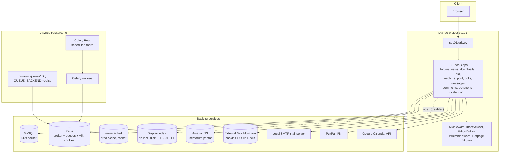

# Research: Codebase State & Test Coverage

**Status:** Static analysis complete; coverage *measurement* deferred (needs the
Dockerized legacy stack to run the suite). Based on reading the code on the hg
`modernize` branch, 2026-07-04.

## 1. High-level architecture

SG101 is a single Django project (`sg101/`) with ~30 local apps plus several
Django contrib apps and a few third-party apps. Settings are split
(`base.py` + per-environment `local.py` / `production.py` / `mac.py` / `test.py`).

## 2. Environment / config facts (from `sg101/settings/`)

- **DB:** MySQL via unix socket (`/var/run/mysqld/mysqld.sock`), **no explicit
  charset/collation set** in `OPTIONS` (classic utf8-vs-utf8mb4 risk — verify in
  the DB-migration research). `CONN_MAX_AGE=1200`.
- **Test DB:** **sqlite3** (`test.py`) for speed → the suite is largely DB-engine
  agnostic today, which *helps* a MySQL→Postgres move but also means MySQL/PG
  quirks are not exercised by tests.
- **Cache:** production uses **memcached** via unix socket; base/local define no
  CACHES (locmem default). → consolidating memcached into Redis is low-risk.
- **Email:** production = **local SMTP** (`localhost:25`, smtp backend); base/dev
  = console backend. (User reports the local mail server is a headache → move to a
  transactional email provider.)
- **Secrets:** `settings/secrets.json` (git/hg-ignored — see `.hgignore`) holds
  `SECRET_KEY`, `DB_*`, `GCAL_CLIENT_ID/SECRET/CREDENTIALS_PATH`,
  `AWS_ACCESS_KEY/SECRET_KEY`, `RECAPTCHA_SITE_KEY/SECRET_KEY`. Loaded via
  `json.load(open(...))`. Not in VCS (good) but **history audit still required**
  before going public.
- **CAPTCHA:** already **Google reCAPTCHA** (custom `siteverify` implementation),
  not a third-party Django app.
- **Media/S3:** `core/s3.py` wraps **boto 2** (`connect_to_region`,
  `OrdinaryCallingFormat`). Two buckets: `sg101.user.photos`,
  `sg101.forum.photos`. `USER_PHOTOS_LOCAL_UPLOAD=True` in production (the local
  fallback the user described); base default is S3.
- **i18n:** `USE_I18N=False` → no translation machinery to worry about.
- **Hardcoded prod-isms:** `celery.py` hardcodes `platform.node()=='jaguar'` for
  role detection and appends `/svr/django-sites/sg101/sg101/tools` to sys.path;
  `production.py` uses unix sockets throughout. All must become env-driven for
  Docker/prod parity.

## 3. Celery / background jobs (real, in use)

From `CELERYBEAT_SCHEDULE` (`base.py`) — Celery is genuinely used:

| Task | Schedule | Notes |
|------|----------|-------|
| `potd.tasks.pick_potd` | daily 00:00 | Photo-of-the-day selection |
| `core.tasks.cleanup` | daily 01:00 | Housekeeping |
| `messages.tasks.purge_messages` | weekly Sun 01:30 | Private-message purge |
| `core.tasks.max_users` | every 15 min | "Most users online" tracker |
| `custom_search.tasks.process_search_queue_task` | every 20 min | **LIVE in production** (processes the Xapian search-update queue). Appears disabled only on the `modernize` branch — see note below. |
| `wiki.tasks.expire_cookies` | daily 02:00 | Expire MoinMoin wiki SSO cookies |

Other `tasks.py` present in: accounts, core, forums, messages, potd, wiki,
custom_search. → Celery must be carried forward (broker can be Redis; memcached
not involved).

> **CORRECTION (user, 2026-07-04):** search (Haystack/Xapian + `custom_search` +
> the search-queue Beat task) **is live in production**. The commented-out state
> on the `modernize` branch is because the user could not get **Xapian to run on
> their old laptop** — which is itself a strong argument for replacing Xapian
> with Postgres FTS. See `search-stack.md`.

## 4. Test landscape (static)

- **434 Python files** (excl. migrations/.hg/.agents).
- Apps **with tests**: core (18), bio (5), accounts (4), antispam/contests/
  forums/messages/wiki (3 each), comments/user_photos (2), and ~1 each for
  bandmap, banners, bulletins, contact, donations, downloads, legacy, news,
  polls, potd, weblinks.
- Apps **with NO tests** (higher regression risk on upgrade): **countdown,
  custom_search, gcalendar, irc, membermap, oembed, podcast, shoutbox, smiley,
  ygroup**, plus sg101 project glue.
- Test infra is reasonable: `test.py` uses sqlite, `CELERY_ALWAYS_EAGER=True`,
  MD5 password hasher, `mock`/`testfixtures` in `requirements_dev.txt`.
- **Coverage numbers: TODO** — run `coverage run manage.py test` inside the
  legacy Docker container. Priority to backfill (risk-based): forums, accounts/
  auth, donations (PayPal), user_photos/S3, comments, messages, search
  replacement.

## 5. Python 2 → 3 surface (static scan, excl. migrations)

The Py2-specific surface is **moderate and concentrated** — good news:

| Pattern | Count | Py3 fix |
|---------|-------|---------|
| `print ` statements (line-start) | ~25 | `print()` |
| `except X, e:` old syntax | ~35 (some false positives) | `except X as e:` |
| octal `0NNN` literals (e.g. `0644`) | 8 | `0o644` |
| `iteritems/iterkeys/itervalues` | 8 | `.items()` etc. |
| `xrange` | 1 | `range` |
| `__unicode__` methods | many (e.g. ygroup) | `__str__` + `python_2_unicode_compatible` then drop |
| `urllib2` (donations IPN) | ≥1 | `urllib.request` / `requests` |
| `boto` (core/s3.py) | 1 module | `boto3` |

Tooling (`python-modernize` / `futurize` / `2to3`) can mechanically handle most
of print/except/octal/iter*/xrange. Manual attention: `urllib2`→requests, boto→
boto3, `__unicode__`, and any implicit str/bytes/unicode assumptions.

## 6. Concrete Django-version breakage already visible

Even before running anything, `settings` + `urls.py` reveal upgrade blockers:

- `MIDDLEWARE_CLASSES` (old style) → must become `MIDDLEWARE` (Django 1.10+).
- `django.contrib.auth.middleware.SessionAuthenticationMiddleware` → removed
  (folded into auth middleware) by Django 2.0.
- `django.conf.urls.url` used throughout → deprecated in 2.0, **removed in 4.0**
  (migrate to `re_path`/`path`).
- Function-based auth views in `urls.py` (`django.contrib.auth.views.
  password_reset`, `password_reset_confirm` with `uidb36`) → became class-based
  in Django 1.11/2.1; `uidb36` → `uidb64`. **Real breakage at the 1.11→2.x rung.**
- `django.core.urlresolvers` (seen in `ygroup/models.py`) → moved to
  `django.urls` in 1.10, removed in 2.0.
- `django.contrib.admindocs` in use (admin/doc/).

## 7. Open questions surfaced for the user (see check-in)

1. **MoinMoin wiki** — the `wiki` app is an SSO/cookie bridge to an *external
   MoinMoin wiki* (itself legacy Py2 software). Is that wiki still live? It's a
   hidden dependency that affects hosting and modernization scope.
2. **`legacy` app** — 12 management commands are all one-off `import_old_*` /
   `translate_old_posts` scripts from the pre-Django (phpBB) migration
   (`phpbb.py`, `html2md.py`). Almost certainly dead one-time importers → strong
   prune candidate. Confirm nothing still references it.
3. **`pycrypto==2.5`** (in requirements_dev) is unmaintained and has known CVEs →
   replace with `cryptography`/`pycryptodome` during modernization. What uses it?
