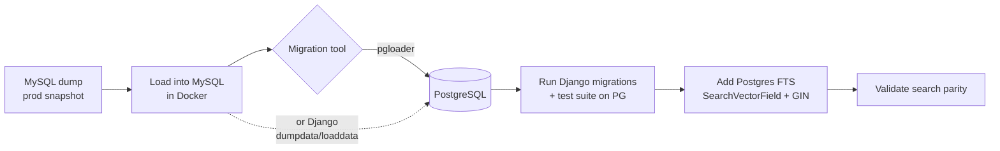

# Research: Database — MySQL today, PostgreSQL candidate

**Status:** Static analysis complete; some items need a production DB snapshot to
finalize. Decision (Q9): decide during research, **leaning Postgres** if it
simplifies the stack.

## Current state

- **Engine:** MySQL (`django.db.backends.mysql`, `mysqlclient==1.4.6`), connected
  via **unix socket** (`/var/run/mysqld/mysqld.sock`) in both `local.py` and
  `production.py`. `CONN_MAX_AGE=1200`.
- **No charset/collation specified** in `DATABASES['default']['OPTIONS']`. Older
  MySQL/Django defaults to `utf8` (3-byte) rather than `utf8mb4` (full Unicode /
  emoji). **Risk to verify against a snapshot:** existing table charset and
  whether 4-byte characters (emoji in posts) are being dropped/mangled today. A
  migration is an opportunity to standardize on full Unicode.
- **Credentials** from `secrets.json` (`DB_NAME`, `DB_USER`, `DB_PASSWORD`).

## Portability signals (encouraging)

- **Zero raw SQL in app code:** no `.raw(`, `.extra(`, `RawSQL`, or
  `connection.cursor()` / `cursor.execute()` outside migrations. The ORM is used
  throughout → high portability to Postgres.
- MySQL-specific strings appear only in **`tools/` shell scripts** (`mysqlimport`
  one-liners for the old Yahoo-group CSV import) and code **comments**
  (`forums/latest.py` notes an operation "can be expensive in MySQL InnoDB") —
  not in ORM queries.
- **Tests already run on sqlite3** (`test.py`) → the app is largely engine
  agnostic; test suite will run on Postgres with little/no change. (Caveat: this
  also means MySQL/PG-specific behavior is *not* currently covered by tests.)

## MySQL → PostgreSQL: what it takes

- **Tooling options:**
  - **`pgloader`** — purpose-built MySQL→Postgres migrator; handles types,
    charset, indexes; fast for a one-shot conversion. Preferred for the bulk data.
  - **Django `dumpdata`/`loaddata`** — simpler conceptually but slow/memory-heavy
    on large forum tables; workable for smaller apps. Likely used as a fallback or
    for verification, not the main path.
- **Type/behavior watch-items (verify on snapshot):**
  - Charset: MySQL `utf8`→ Postgres `UTF8` (true full Unicode). Fix any 4-byte
    truncation.
  - Case-sensitivity: MySQL default collations are case-insensitive; Postgres is
    case-sensitive. Audit uniqueness (usernames, emails, slugs, tags) — add
    ~~`CITEXT` or~~ case-insensitive constraints where the app assumed CI
    behavior. (**Settled in Step 11 task 02: `__iexact` + a functional unique
    index on `LOWER(username)`, not `CITEXT` — see below.**)
  - Booleans/tinyint, auto-increment→serial/identity, `GROUP BY` strictness,
    implicit ordering differences.
  - `AUTO_INCREMENT` gaps / PK sequences reset post-load.
- **Sequencing:** the engine switch is **its own deliberate, well-tested step**
  (Q9) — NOT folded into a Django version jump. Natural placement: after landing
  on Python 3 / a modern Django on the ladder, do the MySQL→Postgres step, then
  immediately build **Postgres FTS** to replace Xapian (see `search-stack.md`).

## Why Postgres (recap of the synergy)

1. **Deletes the entire Xapian/Haystack/queued_search/queues search stack** via
   native `django.contrib.postgres.search` — the biggest single prune, and it
   cures the "can't run Xapian" pain directly.
2. **Removes the persistent-local-disk hosting constraint** (Xapian index) →
   unlocks simpler/managed/stateless hosting.
3. **Managed Postgres is ubiquitous and cheap** on the simpler hosts the user
   prefers (incl. Linode/Akamai) — good fit for "no AWS, keep it simple".
4. Django's best-supported database.

## Fallback
If a snapshot reveals Postgres migration is unexpectedly costly (e.g., heavy
reliance on MySQL-specific collation semantics), **stay on MySQL** (upgrade to a
current MySQL 8.x server at hosting time) and either port Xapian or use a
MySQL-compatible search. This is the documented fallback, not the plan of record.

## To finalize (needs prod DB snapshot)
- Table charsets/collations and presence of 4-byte characters.
- Row counts per app (also feeds `app-triage.md` verify items).
- Any case-insensitive-uniqueness assumptions in code (usernames/emails/tags).

## Snapshot findings (2026-07-12, resolved in Step 1)

Loaded `snapshots/sg10120260712.sql.bz2` into the Dockerized MySQL 5.7 `db`
service. Source: **MySQL 5.5.62 on Ubuntu 14.04** (the legacy prod box),
database `sg101`, **91 tables**. Load was clean (no errors) once the server ran
with 5.5-style permissive `sql_mode=''` (5.7's default STRICT/NO_ZERO_DATE
rejects the dump's `0000-00-00` dates — see `docker-compose.yml` `db.command`).

**Scale (real data):** `auth_user` 15,227 · `forums_topic` 35,692 ·
`forums_post` 463,221 · `news_story` 1,694. Forum posts are the one large table;
everything else is modest. `dumpdata/loaddata` is viable for small apps but
**pgloader** remains the right tool for `forums_post`.

**Charset:** 83 tables are `utf8` (3-byte, `utf8_general_ci`); **8 tables are
`latin1` (`latin1_swedish_ci`)**: `bandmap_bandentry`, `contests_contest`
(+ `_contestants`, `_winners` m2m), `countdown_event`, `django_migrations`,
`messages_flag`, `user_photos_photo`. No `utf8mb4` anywhere → 4-byte characters
(emoji) cannot be stored today; the Postgres migration to true `UTF8` is a net
upgrade. **Migration watch-item (Step 11):** the 8 latin1 tables must be
transcoded latin1→UTF8 on load (declare source encoding to pgloader) to avoid
mojibake; most are low-value/triage apps (`contests`, `countdown`, `bandmap`)
but `messages_flag` and `user_photos_photo` are live.

**Case-sensitivity:** every collation is case-**insensitive** (`*_ci`), so the
app currently gets CI comparisons on usernames/emails/tags for free. Postgres is
case-sensitive → **confirmed need** for CI handling on those columns
at Step 11 (as flagged above).

**Resolved in Step 11 task 02 (2026-07-25), and *not* with `CITEXT`.** Django's
`CIText`/`CICharField`/`CIEmailField` are deprecated in 4.2 and removed in 5.1 —
Steps 13/14 walk straight into that — so adopting them here would have been work
with a scheduled expiry date. What landed instead: 12 collation-dependent lookups
converted to `__iexact` across 9 files, plus a functional unique index on
`LOWER(username)` and normalization of the one genuine email case variant. The
full audit is `research/collation-audit.md`.

**Decision:** findings support the plan of record — **migrate to PostgreSQL**
(the data is ORM-portable, the search stack is being dropped anyway, and utf8mb4
+ Xapian pains both vanish). The two concrete Step 11 tasks are (1) latin1→UTF8
transcoding for the 8 tables and (2) CI uniqueness constraints. No blocker found.
