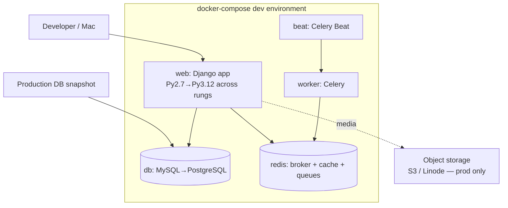

# Research: Containerization & Dev/Prod Parity Strategy

**Status:** Complete (web-verified feasibility, July 2026). User is **new to
Docker** → the plan/design must be well-commented and incremental.

## Feasibility: can we run the legacy Py2.7 stack in Docker?

**Yes.** The official `python:2.7` image is **still available and pullable from
Docker Hub in 2026** (images are frozen; no new security patches — fine for a
*local dev* container). Community guides for standing up Python 2 dev
environments with Docker exist as recently as 2026.

Sources: [Docker Hub python official image](https://hub.docker.com/_/python),
[Setting up a Python 2 dev environment with Docker in 2026](https://docs.bswen.com/blog/2026-03-29-docker-python2-environment/).

Caveats to design around:
- The frozen image has an **old OpenSSL** → the same TLS limitation that pushed
  user off S3. Fine for local dev (we talk to local MySQL/Redis over the Docker
  network, not TLS). Not for production — but production only runs *modern* rungs.
- Some pinned deps may no longer install from PyPI (old sdists, the private
  `queues`/`elsewhere`/`xapian` pins). Mitigation ladder: (1) try faithful pip
  install first (user's preference); (2) vendor/mirror problem packages; (3) for
  **xapian**, likely skip entirely (search stays stubbed locally; replacement is
  Postgres FTS) rather than fight native bindings.

## Target compose topology (evolves across the ladder)

Design principles:
- **One image, env-driven config** (12-factor). Replace `secrets.json` +
  `platform.node()=='jaguar'` role detection with **environment variables**.
  Same image runs dev and prod; behavior differs only by env.
- **memcached is NOT a service** — fold cache into Redis (`django-redis`). One
  fewer container. (memcached was prod-only.)
- **Services the container network provides:** MySQL (later Postgres), Redis.
  Xapian intentionally omitted (see search decision).
- **Seed with real data:** load a production DB snapshot (user has these) into the
  `db` service for realistic testing — the single biggest regression-catcher.
- **Evolution:** the `web` image's base Python and Django pin advance rung by
  rung; the `db` service switches MySQL→Postgres at the DB step. The compose file
  is version-controlled and is the *same artifact family* used for deployment.

## Dev vs. prod parity → deploy at the end

Per the sequencing decision (do everything locally, deploy once at the end), the
compose stack is built for production use from day one:
- Dev override (`docker-compose.override.yml`): DEBUG, console email, debug
  toolbar, local volumes.
- Prod compose: DEBUG off, real transactional email, object storage for media,
  managed or containerized Postgres, gunicorn + a reverse proxy (nginx/Caddy) or
  the platform's router, `collectstatic` + WhiteNoise or platform static serving.
- This makes the final cutover "run the prod compose against a fresh snapshot +
  switch DNS," not a separate productionization scramble.

## Static files
- Prod currently uses `ManifestStaticFilesStorage` + a `static_serve` dir served
  by Apache (`sg101/apache/`). In the container world, use **WhiteNoise** (serve
  static from the app, simplest for a single-container PaaS) or the platform's
  static/CDN. Media (user uploads) goes to **object storage** (see hosting.md),
  not local disk.

## Open items
- Decide gunicorn+nginx/Caddy vs. WhiteNoise-only (depends on hosting shape).
- Confirm whether to attempt xapian-in-Docker at all (recommend: no).
- Node/gulp/bower front-end build (`sg101/gulpfile.js`, `bower.json`,
  `package.json`) — bower is dead; assess whether the asset pipeline needs
  modernizing or if built assets can be committed. (Lower priority; front-end
  refresh is out of scope per Q1.)
