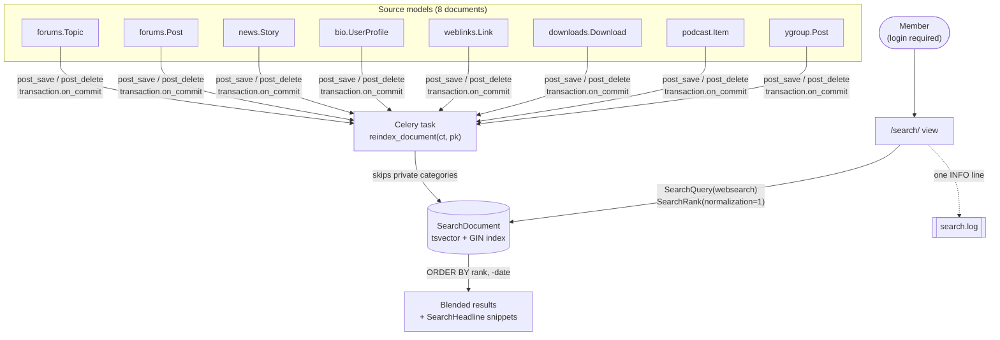

# Search design — Step 12 (PostgreSQL full-text search)

The design settled for restoring `/search/`, from the requirements clarification
in `../step12-idea-honing.md` (Q1–Q11, 2026-07-26). That file holds the reasoning
and the rejected alternatives; this one states what is being built.

Companion to `search-stack.md`, which established *that* Postgres FTS replaces
Xapian/Haystack. This establishes *what* gets built.

---

## 1. What the old search did

Step 4 deleted the Xapian/Haystack stack but left its templates, and the removed
code is recoverable at the `pre-step-4-prune` tag. Prior behavior is therefore
documented rather than remembered:

| Aspect | Old behavior | Source |
|---|---|---|
| Access | **Login required** — anonymous users redirected to `/accounts/login/` | `custom_search/views.py` |
| Form | Three boxes: keywords / exact phrase / exclude, AND-ed | `templates/search/search.html` |
| Query built | `terms "exact phrase" -excluded` — **one synthesized string** | `custom_search/forms.py` |
| Type filter | Checkbox group; none checked meant all | `CustomModelSearchForm` |
| Ordering | **Newest first** (`SearchQuerySet().order_by('-pub_date')`) | old `sg101/urls.py` |
| Results | One blended list: `verbose_name: title (score)` + highlighted 200-char summary | `search.html` |
| Logging | One `INFO` line per search: terms, models, username, IP | `forms.py` |
| Known gap | Indexer stripped punctuation — `FRV-1` found nothing | tips block |

Two details from that table shaped the design more than anything else. **The old
search was date-ordered, not relevance-ordered**, despite rendering a score. And
**the three boxes were only ever a UI over websearch syntax** — the form
synthesized `terms "exact phrase" -excluded` and handed Xapian a single string,
which is exactly what `websearch_to_tsquery` parses.

Still on disk and reusable: `search_title` / `search_summary` properties on every
searchable model, `templates/search/indexes/*/*.txt` recording precisely which
fields were indexed, the results template, the quick-search fragment, and the
masthead search box at `v3/base.html:49`.

---

## 2. Decisions

| # | Question | Decision |
|---|---|---|
| 1 | Result ordering | Relevance (`ts_rank`), newest as tiebreak |
| 2 | Search form | Single box, `websearch` syntax; type checkboxes kept, all checked by default |
| 3 | What's searchable | All 8 documents; member profiles at full parity |
| 4 | Private content | Private categories not indexed at all |
| 5 | Index freshness | All updates via Celery, queued on `transaction.on_commit` |
| 6 | Typo tolerance | Skipped for now; additive later |
| 7 | Forums quick search | Restored, reusing the existing fragment template |
| 8 | Score scaling | `normalization=1` (÷ `1+log(len)`) + `setweight` A/B/C |
| 9 | Comments | Not indexed — parity; additive later |
| 10 | Abuse defence | Login gate only; rate limiting deferred |
| 11 | Query logging | Kept — existing behavior, moved to a dedicated `search.log` |

**Revised 2026-07-27, after Q5:** author **full names** are indexed only on the
`bio.UserProfile` document, not on content documents, which removes the
author-rename fan-out entirely. See §3, "Index maintenance".

---

## 3. Architecture

One denormalized search table. Q1 (relevance ordering) and Q4 (private content
excluded) between them force it: a blended, relevance-ordered, *paginated* list
across eight document types cannot be assembled by querying eight models and
merging in Python, because global ordering would require fetching every match
from every model before slicing a page.



### The search table

One row per indexed document:

| Column | Purpose |
|---|---|
| `content_type` + `object_id` | What this row indexes (generic pointer to the source) |
| `search_vector` | Weighted `tsvector`, **GIN-indexed** |
| `title` | The document's **weight A** text, and the result heading |
| `summary` | The document's **weight B** text, and the snippet source |
| `author` | The document's **weight C** text |
| `url` | From `get_absolute_url`, so results render without touching source tables |
| `date` | The document's own date, for the recency tiebreak |
| `indexed_at` | When this row was last rebuilt — the reconcile sweep's watermark |

Denormalizing title/summary/url means a result page renders from this table
alone — no N+1 fan-out across eight models to display ten rows.

**Revised 2026-07-28, building task 01: the three text columns hold the text to
be *indexed*, and the vector is a function of them** — `setweight(to_tsvector(
title),'A') || ... (summary),'B') || ... (author),'C')`. This is the pattern in
the Django FTS docs; passing the text in from Python as `Value()` literals is the
variant off the beaten path. It costs one column beyond the sketch above
(`author`) and means a vector can be rebuilt from this table alone.

The models' existing `search_title` / `search_summary` therefore go unused, except
on `bio.UserProfile` where `search_title()` already returns the wanted A text.
They do not survive contact with weighting: `forums.Topic` and `forums.Post` embed
the username *and* a formatted date in their title, which would put the author at
A instead of C and tokenize `12-Jan-2020` into every post's high-weight terms, so
`2020` would match half the forum. Result lines are composed instead by the
template from `title` + `author` + `date`, uniformly for all eight types — a forum
topic loses its "; 3 posts", while news, links, downloads and podcasts gain a
visible author. Byte-identical parity with the Xapian result lines was explicitly
not a requirement.

Defining `summary` as *what should be indexed* also closes three gaps that
`search_summary()` had: `news` regains its `tags`, `weblinks` regains its `url`,
and `bio` sheds the username and full name that belong at A. HTML is stripped
from body text on the way in — every news story stores rendered HTML rather than
the markup it came from, as does 40% of the Yahoo Group archive, and this text is
both indexed and shown in snippets.

### Weighting and ranking

`setweight` is applied when the vector is built:

| Weight | Content |
|---|---|
| **A** | Title / topic name |
| **B** | Body / description |
| **C** | Author **username** (not full name — see below) |

On the `bio.UserProfile` document the author *is* the document, so username and
full name both sit at **A**, with location, occupation, interests, profile text
and linked sites at **B**.

Ranking is `SearchRank(vector, query, normalization=Value(1))` — divide by
`1 + log(document length)` — so a long forum post does not outrank a tight news
headline on bulk alone.

**Know which knob is which.** Normalization is a *query-time* argument: revising
it is a one-line change. Weights are baked into the stored vector: changing those
requires recomputing every row. Get the weights right first; tune normalization
freely afterwards. (Since task 01 built the vector from the row's own columns,
that recompute is one `UPDATE` over the search table rather than a re-read of
eight source models — but it is still 490k rows either way.)

### Index maintenance

Every write goes through Celery, queued on commit:

```python
transaction.on_commit(lambda: reindex_document.delay(ct_id, pk))
```

Never queue directly in `save()` — the worker can pick the task up before the
transaction commits, read a row that does not exist yet, and index nothing. That
failure is intermittent and load-dependent. Queueing on commit also gives correct
rollback behavior for free.

**Added 2026-07-30: the hook is `post_save`, not the app's own content-update
signals.** `forums/signals.py` and `bio/signals.py` still ship
`topic_content_update`, `post_content_update` and `profile_content_update`, which
the old `QueuedSignalProcessor` used in place of `post_save` so that saves
changing no text did not reindex — `profile.save(content_update=False)` fires on
every forum post to bump `forum_post_count`. Not adopted: those signals are sent
by hand from a handful of call sites, and one that someone forgets to add is an
index that goes quietly stale, which is the failure this design exists to
prevent. `post_save` cannot be bypassed. The cost is two extra cheap tasks per
post at 134 posts a month.

Three senders go beyond the eight searchable models, each because the searchable
object is never saved when the thing that changed is: `forums.Category` (its
groups decide whether its content may be indexed), `User` (a profile document's
weight-A full name and its `is_active` gate both live there, and the auth admin
edits it alone), and `elsewhere.WebsiteProfile` (a member's website links are
indexed at weight B but live in their own model).

Note that `forums`' `topic_content_update` and `post_content_update` are **not**
search code and stay: `forums/latest.py` receives both for the Redis latest-posts
datastore behind the RSS feeds. Only `bio`'s `profile_content_update` was
search-only, and it has had no receiver since Step 4 — it goes in the
end-of-Step-12 prune with the other Xapian residue.

**There is no author-rename fan-out, by construction** (revised 2026-07-27 —
supersedes Q5's "a rename is its own task"). Two facts settle it:

- **`username` is immutable.** It is written exactly once, at account activation
  (`accounts/utils.py:20`). No form anywhere edits it; only an admin can, and
  the admin is the site owner, who can run the reindex command.
- **`first_name` / `last_name` are user-editable** via `bio.EditUserForm`, and
  they are the *only* mutable author text — which is why they are indexed **only
  on the `bio.UserProfile` document**, never on posts, topics, news, downloads
  or links. A name change therefore rebuilds exactly **one row**, handled by the
  same `reindex_document` path as any other edit.

Had full names stayed embedded in content documents, one profile edit by
`bigtikidude` would have rebuilt **25,768 rows**, triggered by an ordinary
user-facing form — so the "we'll notice and re-run the command" fallback would
not have held. Dissolving the cascade beat managing it.

**Accepted cost:** forum posts are findable by author *handle*, not by the
author's real name. Only 2,937 of 15,227 members (19%) have a full name set at
all, and finding *people* by real name still works through the profile document.
Additive later if wanted: it needs the embedding plus a batched fan-out task.

A downed worker means a stale index. **A weekly reconcile sweep was originally
declined and is now taken** (revised 2026-07-27), because measuring it changed
the picture: a reconcile does not have to rebuild anything.

It compares sets and timestamps in SQL — missing rows, orphaned rows, and rows
whose `indexed_at` predates the source's `update_date` — so **its cost scales
with the drift it finds, not with the corpus**. The dominant term, scanning
`id, update_date` across all 463,222 forum posts, measures **170 ms**; the full
eight-type sweep should land in the low single-digit seconds. Weekly is free.

Two facts made the timestamp comparison available: seven of the eight documents
carry a `db_index=True` `update_date`, and the eighth, `ygroup.Post`, is a frozen
archive that cannot drift. `SearchDocument` therefore carries an `indexed_at`
column from the start — adding it later would mean a migration plus a backfill
over 490k rows.

**It reports; it does not repair.** Task 03's incremental indexing is supposed to
make drift impossible, and the sweep exists to find out whether that holds.
Auto-repair would mask exactly the bugs worth finding, and becomes a small change
once there is evidence. It also reports any index row pointing into a private
category separately, since that is a privacy defect rather than staleness.

### Access and exclusions

- **Login required**, carried forward from the old view. It is an anti-abuse
  measure: bots were hammering search hard enough to hurt the site.
- **Private categories are never indexed.** The indexer keys off
  `Category.groups` being non-empty. Production has one such category —
  `Kahunas`, 487 topics and 19,088 posts — and those are unfindable by search
  even for the members allowed to read them. Deliberate; revisitable additively.
- A category's privacy is **not fixed**: one that becomes private must have its
  rows removed, and one that becomes public must gain them.

**Added 2026-07-30, building task 03: private categories are not the only
exclusion, and the other three were being missed.** Each document's queryset
carries whatever rule decides its model is visible on the site at all, since
search must not surface what a member cannot otherwise reach:

| Document | Rule | Was wrongly indexed |
|---|---|---|
| `forums.Topic`, `forums.Post` | the category's groups | — (task 02) |
| `weblinks.Link` | `is_public`, an admin's approval | 57 of 571 |
| `downloads.Download` | `is_public` | 43 of 716 |
| `bio.UserProfile` | the user's `is_active` | 1,637 of 15,227 |

`news.Story`, `podcast.Item` and `ygroup.Post` have no such rule: the first
keeps unapproved submissions in a separate `PendingStory` model, the second has
no flag of any kind, and the third is a frozen archive. All three rules that
were missing had been in the old Xapian indexes (`Model.public_objects` and
`UserProfile.objects.filter(user__is_active=True)`), so they were recovered
rather than invented. The downloads case was the sharpest: `downloads-details`
is `get_object_or_404(Download.public_objects, ...)`, so an unapproved download
in the index is a search hit that 404s on click.

### Logging

A `search` logger with its own `RotatingFileHandler` writing `logs/search.log`,
`propagate: False` — parallel to the existing `auth` logger and `auth.log`:

```python
logger.info('Search: %s in %s by %s [%s]', query, models, username, ip)
```

---

## 4. Corpus, measured

| Document | Rows |
|---|---|
| `forums.Post` | 463,221 (less 19,088 private) |
| `forums.Topic` | 35,692 (less 487 private) |
| `bio.UserProfile` | 15,227 |
| `news.Story` | 1,694 |
| others (links, downloads, podcast, ygroup) | remainder |

Roughly **490k rows** to index. Write rate is low — 134 forum posts in the last
30 days — so steady-state indexing is trivial; the initial backfill is the only
bulk operation.

Not indexed: 10,987 comments (72% of them Photo-of-the-Day chatter), and the
private category above.

---

## 5. Deferred, with reasons

| Item | Why deferred | Cost to add later |
|---|---|---|
| "Did you mean" (`pg_trgm`) | Speculative; needs a tuned threshold | Additive — only runs on the zero-result path, and `search.log` will show the zero-result rate |
| Comments in the index | 72% is POTD chatter; needs `is_public`/`is_removed` handling and a title/summary contract | Additive |
| Private-category search | Would need an access key per row and a per-user query filter | Additive column + backfill |
| Rate limiting | Login gate may be sufficient now that queries are milliseconds | An afternoon at the view |
| Sort toggle (relevance/newest) | Both orderings fall out of the same query | Form field + query branch |
| Finding posts by author's *real* name | Embedding it in content documents brings back a 25,768-row rename fan-out for a field only 19% of members set | Embed at weight C + a batched fan-out task on `bio.EditUserForm` saves |
| Shrinking the index by dropping the stored `summary` | Measured 2026-07-28 and **accepted**: the search table roughly doubles the database. Revisit only if it becomes a problem | Drop the column, fetch result objects to render snippets, highlight in Python — and the weight-B text leaves the row, so the vector goes back to `Value()` literals |

### What the index actually costs (measured 2026-07-28)

Brian asked whether the search table duplicates data. It does, and the numbers are:
**~196 MB** of source text copied into `summary` (164 MB of it forum post bodies,
29 MB Yahoo Group), a tsvector running **~110% of the text it covers**, and a GIN
index over that — against a **544 MB** database today.

Two things keep it in proportion. **The tsvector and its GIN index are unavoidable
in any Postgres FTS design** — that *is* the index; only the text copy is
duplication a different design could avoid. And **Xapian was doing the same thing**,
outside MySQL: each `search_indexes.py` declared
`text = CharField(document=True, use_template=True)`, rendering
`search/indexes/<app>/<model>_text.txt` into a blob Xapian stored and indexed on
local disk. That file-based copy is the persistent-disk hosting constraint Postgres
FTS dissolves — the copy now lives in the database, backed up with it and
transactional.

Where this goes further than Haystack: Haystack did **not** store title, url or
date. `search.html:91` renders `result.object.search_title`, and `result.object` is
a lazy fetch back to MySQL once per result; highlighting was Python-side too
(``, line 94). Storing those four small columns is what makes a
results page a single query instead of an N+1 across up to eight models.

---

## 6. Carried into implementation

- `templates/search/search_ajax.html` has a **pre-existing markup bug**:
  `</fieldset>` and `</div>` sit inside the `` branch, so neither closes
  when there *are* results.
- Routes are still named `haystack_search` / `haystack_search_ajax`, after a
  library that no longer exists. **Corrected 2026-07-28 — the rename is wider than
  first recorded: 8 references across 6 templates**, not the three named here.
  `v3/base.html` (lines 49 and 154), `base.html:61`, `navbar.html:7`,
  `bio/members.html:10`, `ygroup/thread_list.html:10`,
  `ygroup/v3/thread_list.html:10`, plus the 2 definitions in `sg101/urls.py`.
- **`search.html` is already latently broken** (found 2026-07-28). Its second line
  is `` — `haystack.templatetags.highlight` — and haystack left
  `requirements.txt` and `INSTALLED_APPS` in Step 4, so rendering the template
  raises `TemplateSyntaxError` today. Harmless only because the view is still the
  stub and nothing renders it. `` is what `SearchHeadline` replaces.
- Checkbox labels and order, recovered verbatim: Forum Topics, Forum Posts, News
  Stories, User Profiles, Links, Downloads, Podcasts, Yahoo Group Archives.
- Validation: an empty query is rejected with "Please supply some search terms".
- A reindex management command is needed regardless — for the initial ~490k-row
  backfill and for rebuilding after any weight change.
- The old tips block apologises that `FRV-1` finds nothing. Postgres's parser
  emits both the whole hyphenated token and its parts, so **this limitation may
  simply be gone** — confirm against real data, and if so, say so in the
  rewritten tips.
- `'english'` is the assumed text search configuration. Band and song names are a
  large share of queries and not all are English; `'simple'` (no stemming) is the
  alternative if stemming proves to hurt more than help.

**Flagged for Step 21:** file-based logging needs a mounted volume and
in-container rotation under Docker. Step 12 follows the existing `auth.log` house
style deliberately — moving all logging to stdout is one coherent decision for
the deploy step.

---

## 7. References

- [Django: full-text search](https://docs.djangoproject.com/en/3.2/ref/contrib/postgres/search/)
  (3.2 — the version this is built on)
- [Django: `django.contrib.postgres` indexes](https://docs.djangoproject.com/en/3.2/ref/contrib/postgres/indexes/)
- [PostgreSQL 16: full text search](https://www.postgresql.org/docs/16/textsearch.html)
- [pganalyze: efficient Postgres full-text search in Django](https://pganalyze.com/blog/full-text-search-django-postgres)

**Version note.** `SearchHeadline`, `search_type='websearch'` and `SearchRank`'s
`normalization` all require Django ≥ 3.1 and PostgreSQL ≥ 11 — satisfied by 3.2
and PG 16, so nothing here waits on the remaining rungs. Django 5.0's
`GeneratedField` could later let Postgres maintain the vector itself, retiring
some of the Celery machinery; revisit at **Step 14**.
