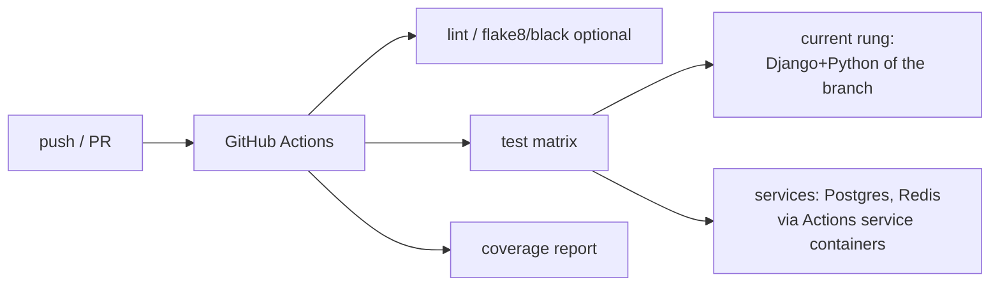

# Research: hg → git Migration, Going Public & CI

**Status:** Complete (approach + tooling). Decisions from Q7.

## Goal
Convert the Mercurial repo to **git on public GitHub**, **preserving branch
history** (including the `modernize` branch), vendor private deps, and stand up
**GitHub Actions** CI.

## History-preserving conversion

Options (all preserve commit history):
- **`hg-fast-export`** (fast-export.git) — mature, maps hg commits/branches to git;
  the common choice. Handles named branches → git branches.
- **`git-cinnabar`** — lets git talk to hg directly; good for incremental sync but
  heavier to set up; useful if you want to keep hg and git in sync during transition.

Recommended: **`hg-fast-export`** for a one-shot conversion.

Steps (to detail in the plan):
1. Install `hg-fast-export`; run against a fresh clone of the hg repo.
2. Produce an author map (hg `user` → `Name <email>`), e.g. Brian Neal →
   `bgneal@gmail.com`.
3. Verify branches (`default`→`main`/`master`, `modernize`, `v3-dev`,
   `abandoned-2015`) and tags (`.hgtags`) carried over. Confirm `modernize` work
   is intact. **Head-parity check:** the count of git branches must match
   `hg heads --topo --closed` (4) — see head inventory below.
4. Add a `.gitignore` mirroring `.hgignore` (`*.pyc`, `secrets.json`, `*.db`,
   `*.log`, `xapian_index`, media dirs, `node_modules`, `bower_components`,
   `static_serve`, `celerybeat-schedule`, `snapshots/*`, `.env`,
   `.claude/settings.local.json`, `*.pid`, etc.).

## Head inventory & pre-conversion prep (resolved 2026-07-13)

`hg-fast-export` gives a git ref only to **named-branch tips** and **bookmarks**;
anonymous heads (extra heads on a branch) and closed heads get **no ref** and
become dangling/GC-eligible commits. The repo has **4 topological heads**, two of
which were loose. Bookmarked the loose ones so every head converts to a findable
git branch (bookmarks are additive, don't touch history):

| Rev | Branch | State | Ref that survives conversion |
| --- | --- | --- | --- |
| 1263 | `modernize` | open | branch `modernize` (Step 1 work) |
| 1260 | `default` | open | branch `default`→`main` (tip) |
| 1171 | `default` | open (anonymous 2nd head) | **bookmark `v3-dev`** (2018 "V3 dev branch") |
| 960 | `default` | **closed** 2015 | **bookmark `abandoned-2015`** ("not going to pursue this now") |

Done via `hg bookmark -r 1171 v3-dev` and `hg bookmark -r 960 abandoned-2015`
(inactive bookmarks; working copy stayed on `modernize`). After conversion,
confirm git branches `main`, `modernize`, `v3-dev`, `abandoned-2015` all exist
and point at the right commits before pushing.

## Visibility decision (2026-07-13): PRIVATE initially, public later

Changed from the original "public GitHub" (Q7). Rationale: for solo hobby
modernization, private costs ~nothing, is fully reversible (flip visibility
anytime), and **removes the time-pressure on secret work** (public repos are
scraped by bots within seconds). Only real tradeoff: private Actions minutes are
capped (~2,000/mo Free) vs unlimited public — a non-issue at weekend-burst
cadence with a ~7s suite (keep Docker image layers cached so CI doesn't rebuild
the Py2.7 image every run).

## Secret hygiene — TWO audits

**Audit #2 is now Step 22 (added 2026-09-21), together with the LICENSE file that
depends on it.** It had lived here and in Step 2's detail prose as a forward
reference with no checklist item, which is how a gate goes unrun. `plan.md` has
the step; this section stays as its definition.

Private-initially relaxes *urgency*, not the *need*. Two passes:

- **Audit #1 — during Step 2 (repo private).** `gitleaks` + `trufflehog` on the
  full converted history. `secrets.json` is hg-ignored (never tracked) — good —
  but scan for anything that slipped into old commits (old `settings.py` values,
  keys, passwords). **Rotate anything LIVE immediately** (Django `SECRET_KEY`, DB
  creds, AWS keys, reCAPTCHA keys, Google OAuth secret) — a credential sitting in
  history may already be compromised, independent of repo visibility. Establishes
  a known baseline.
- **Audit #2 — before flipping to public (the gate).** Re-scan the delta added
  during Steps 3–21 (env-var config etc., where a key could slip in) + a final
  full pass; confirm clean; verify `.gitignore`; rotate stragglers. *Then* change
  visibility.

Note: **rotation ≠ removal** — rotating makes an exposed secret dead, but the old
value remains in history (normally fine). Optional `git filter-repo` scrub to
physically remove per-finding.

Also: move all secrets to **environment variables** (12-factor) in Step 3; keep a
committed `.env.example`/`secrets.json.example` with placeholders (the latter
already added in Step 1).

## Vendoring private/at-risk dependencies

- **`elsewhere`** (django-elsewhere): user already has a **GitHub fork** — reuse
  it (pin a commit, or vendor into the repo). Must be ported to Py3.
- **`queues`** (private `bobcat` hg): vendor into the repo *or* moot if Postgres
  FTS removes queued_search (likely). Decide with the search decision.
- **`xapian-haystack`** pin: moot if Postgres FTS.
- Rehome any other `-e git+…` / `-e hg+…` editable installs from
  `requirements.txt` into normal pinned deps or vendored packages so CI can build.

## GitHub Actions CI design

- **Service containers:** Actions can run **Postgres** and **Redis** as service
  containers for the test job (no need for MySQL once migrated; sqlite also fine
  for fast unit runs, but test on the real DB engine too).
- **Matrix across the transition:** while climbing, pin the job to the current
  rung's Django+Python; optionally test N and N+1 to de-risk the next jump.
- **Warnings-as-errors:** run tests with `-W error::DeprecationWarning` to enforce
  the per-rung deprecation-clearing discipline (Q10).
- **Coverage:** upload coverage (artifact or a badge service) to track the
  risk-based coverage goal.
- **Public repo → unlimited free Actions minutes.**
- The **same Docker image** used for dev can back the CI job for parity.

## Sequencing note
The hg→git move + secret audit + CI can happen **early** (before/alongside the
Docker work) so all subsequent rung work runs under CI. It does not depend on the
Django ladder.

## Open items
- Confirm the GitHub repo name/owner and public visibility.
- ~~Enumerate hg named branches/bookmarks to preserve beyond `modernize`.~~
  **Resolved 2026-07-13** — see "Head inventory & pre-conversion prep": 4 heads,
  bookmarked `v3-dev` (1171) and `abandoned-2015` (960).
- Pick lint/format tooling (optional): black + flake8/ruff.
