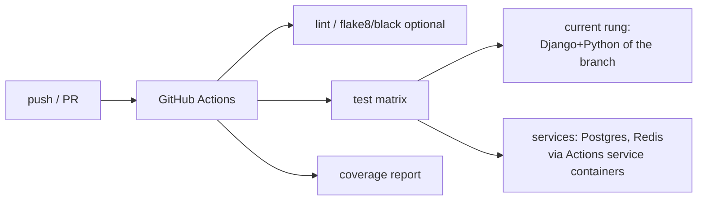

# Research: hg → git Migration, Going Public & CI

**Status:** Complete (approach + tooling). Decisions from Q7.

## Goal
Convert the Mercurial repo to **git on public GitHub**, **preserving branch
history** (including the `modernize` branch), vendor private deps, and stand up
**GitHub Actions** CI.

## History-preserving conversion

Options (all preserve commit history):
- **`hg-fast-export`** (fast-export.git) — mature, maps hg commits/branches to git;
  the common choice. Handles named branches → git branches.
- **`git-cinnabar`** — lets git talk to hg directly; good for incremental sync but
  heavier to set up; useful if you want to keep hg and git in sync during transition.

Recommended: **`hg-fast-export`** for a one-shot conversion.

Steps (to detail in the plan):
1. Install `hg-fast-export`; run against a fresh clone of the hg repo.
2. Produce an author map (hg `user` → `Name <email>`), e.g. Brian Neal →
   `bgneal@gmail.com`.
3. Verify branches (`default`→`main`/`master`, `modernize`, others) and tags
   (`.hgtags`) carried over. Confirm `modernize` work is intact.
4. Add a `.gitignore` mirroring `.hgignore` (`*.pyc`, `secrets.json`, `*.db`,
   `*.log`, `xapian_index`, media dirs, `node_modules`, `bower_components`,
   `static_serve`, `celerybeat-schedule`, etc.).

## Going public — secret hygiene (must-do before push)

`secrets.json` is **hg-ignored** (not tracked), so the main secret file was never
committed — good. Still required before making the repo public:
- **Scan full history** for accidentally committed secrets (old `settings.py`
  values, keys, passwords) using e.g. `gitleaks` / `trufflehog` on the converted
  git repo.
- If anything is found: **rotate** it (Django `SECRET_KEY`, DB creds, AWS keys,
  reCAPTCHA keys, Google OAuth client secret) and scrub history (`git filter-repo`)
  before the repo ever goes public.
- Move all secrets to **environment variables** (12-factor) as part of the Docker
  work; keep a committed `secrets.example`/`.env.example` with placeholders.

## Vendoring private/at-risk dependencies

- **`elsewhere`** (django-elsewhere): user already has a **GitHub fork** — reuse
  it (pin a commit, or vendor into the repo). Must be ported to Py3.
- **`queues`** (private `bobcat` hg): vendor into the repo *or* moot if Postgres
  FTS removes queued_search (likely). Decide with the search decision.
- **`xapian-haystack`** pin: moot if Postgres FTS.
- Rehome any other `-e git+…` / `-e hg+…` editable installs from
  `requirements.txt` into normal pinned deps or vendored packages so CI can build.

## GitHub Actions CI design

- **Service containers:** Actions can run **Postgres** and **Redis** as service
  containers for the test job (no need for MySQL once migrated; sqlite also fine
  for fast unit runs, but test on the real DB engine too).
- **Matrix across the transition:** while climbing, pin the job to the current
  rung's Django+Python; optionally test N and N+1 to de-risk the next jump.
- **Warnings-as-errors:** run tests with `-W error::DeprecationWarning` to enforce
  the per-rung deprecation-clearing discipline (Q10).
- **Coverage:** upload coverage (artifact or a badge service) to track the
  risk-based coverage goal.
- **Public repo → unlimited free Actions minutes.**
- The **same Docker image** used for dev can back the CI job for parity.

## Sequencing note
The hg→git move + secret audit + CI can happen **early** (before/alongside the
Docker work) so all subsequent rung work runs under CI. It does not depend on the
Django ladder.

## Open items
- Confirm the GitHub repo name/owner and public visibility.
- Enumerate hg named branches/bookmarks to preserve beyond `modernize`.
- Pick lint/format tooling (optional): black + flake8/ruff.
