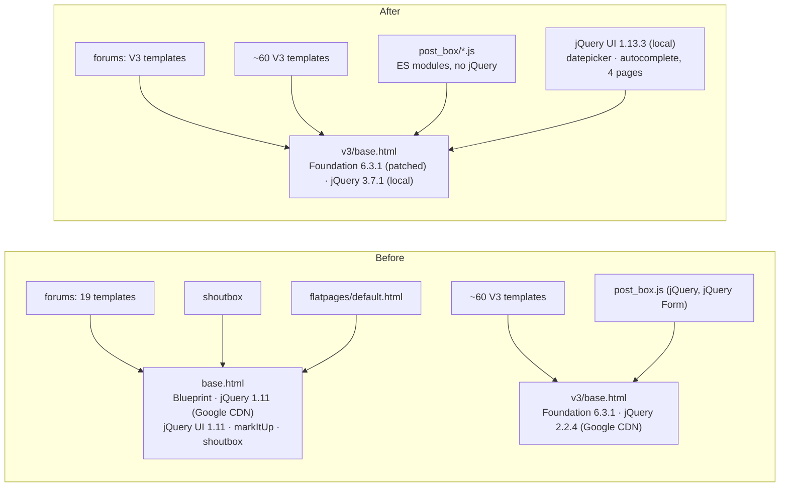
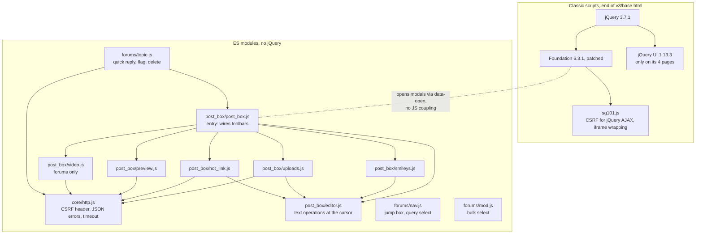
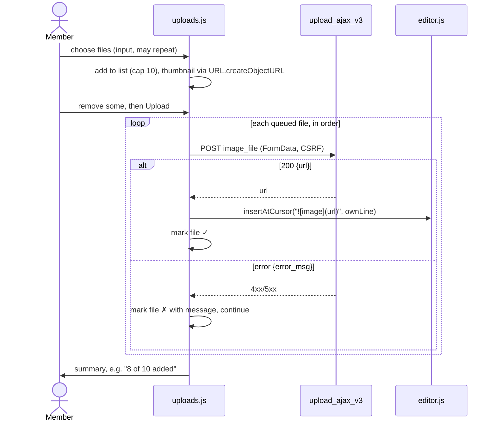
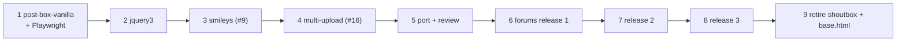

# Detailed design: the V3 forums, the post box, and the site's JavaScript

**Project:** `.agents/planning/2026-10-10-v3-forums-and-js/`
**GitHub issues:** #9 (smileys), #16 (multiple image uploads), #17 (finish the
forums' V3 design), #18 (modernize the site JavaScript)
**Written:** 2026-10-10, from `idea-honing.md` (Q1–Q13) and `research/`

## 1. Overview

SurfGuitar101.com moved most of its pages from Blueprint CSS to the Foundation
framework ("V3") years ago, merged to mainline a chunk at a time. The forums,
the busiest part of the site, were the last big piece. A 2017 branch, `v3-dev`,
converted three forum pages before the work stopped. Today the site still runs
two designs: `base.html` (Blueprint, jQuery 1.11, jQuery UI, markItUp, the
shoutbox), used by the forums and a few leftovers, and `v3/base.html`
(Foundation 6.3.1, jQuery 2.2.4), used by everything else.

This project finishes the job:

- **The shared V3 "post box" editor** gains smileys and multi-image upload,
  and is rewritten without jQuery.
- **jQuery 2.2.4 becomes 3.7.1**, served from the site.
- **The forums move to V3** in three releases, built from `v3-dev`.
- **The shoutbox and `base.html` are retired**, and with them Blueprint, jQuery
  1.11 and markItUp.

Foundation stays on 6.3.1.

## 2. Detailed requirements

Consolidated from `idea-honing.md`. The question each comes from is in brackets.

### 2.1 Scope

- **R1.** Issues #9, #16 and #17, and as much of #18 as the decisions below
  allow. [rough idea]
- **R2.** Remove the shoutbox app (its data archived first) and retire
  `base.html` with everything only it loads: Blueprint CSS, jQuery 1.11 and
  markItUp. [Q5]
  - **jQuery UI is not removed:** at least four V3 pages use it. [Q5,
    research topic 7]
  - **Flatpages are out of scope.** They are GitHub #33, independent of this
    project. If #33 hasn't landed when `base.html` is retired, that step
    deletes `flatpages/default.html`. [Q5]
- **R3.** Stay on Foundation 6.3.1. A framework change or Foundation upgrade is
  out of scope. [Q12, Q13]
- **R4.** Out of scope: video embedding outside the forums [Q8], replacing
  jQuery UI's datepicker and autocomplete [research topic 8], and the image
  resize bug (GitHub #32).

### 2.2 JavaScript

- **R5.** No jQuery in new or rewritten code. jQuery stays only as long as
  Foundation's JavaScript needs it. Removing it entirely is deferred, and would
  most likely mean leaving Foundation. [Q1]
- **R6.** No build step. Plain files served as they are, using native ES
  modules (`<script type="module">`) where sharing code helps. [Q2]
- **R7.** jQuery 3.7.1 replaces 2.2.4, served from the site, not Google's CDN.
  It requires: a one-line patch to the vendored Foundation 6.3.1, jQuery UI
  1.11.0 → 1.13.3 (JS and theme), and `comments.js` `.size()` → `.length`.
  There is no jQuery Migrate in production. [Q13, research topic 8]

### 2.3 The post box

- **R8. Smileys** [Q3]: a toolbar button opens a Foundation reveal (modal)
  showing every smiley, the main set first. Clicking one inserts its code at
  the cursor.
- **R9. Multiple image uploads** [Q4]:
  - choose up to **10** images, listed with thumbnails, each removable before
    upload
  - Upload sends **one request per image, one after another**
  - each image's code is inserted as it finishes
  - a failure is shown against its file and the rest continue
  - the upload endpoint keeps its contract
- **R10. A rejected upload says why** [research topic 6]: every error path of
  the upload endpoint returns its message in `error_msg`.
- **R11. Video** [Q8]: a toolbar button that **appears only on the forums**. It
  adds the video to the post's attachment list (not to the Markdown). News,
  comments and messages are unchanged. This depends on the phone toolbar
  fitting with 7 visible buttons. If they don't fit, tighten the spacing or move
  a button to the hidden-on-small set.

### 2.4 The forums

- **R12.** Port the three `v3-dev` pages first (forums index, a forum's topic
  list, a topic). Brian reviews screenshots at phone and desktop widths before
  the remaining pages are built on the look. [Q6]
- **R13.** Release in groups as each is done [Q7]:
  - **Release 1:** the reading pages; the three posting forms (new topic,
    reply, edit) with the video button; and the three confirmation pages (new
    topic thanks, favorite status, subscription status). [Q10]
  - **Release 2:** the list pages (unread/unanswered/active topics, a member's
    posts, favorites and subscriptions management).
  - **Release 3:** the seven moderator pages.
- **R14.** The V3 topic page keeps every capability of today's:
  - per-post anchors and permalinks
  - quote-reply, edit, flag and delete
  - the moderator's stranger and spammer tools
  - attachments, signatures and "Last edited"
  - PM and email links
  - the stranger highlight, and the IP link for moderators

  [research `v3-dev-forums.md`]

### 2.5 Testing

- **R15.** A small set of Playwright browser tests for the paths that fail
  silently. Everything else is checked by hand in a browser. [Q9]

### 2.6 Order and branches

- **R16.** Order [Q10, Q13]:
  1. post box without jQuery, with Playwright
  2. jQuery 3
  3. smileys
  4. multiple uploads
  5. port and review
  6. release 1
  7. release 2
  8. release 3
  9. shoutbox and `base.html`
- **R17.** One short-lived branch per shippable step, cut from `main` and
  merged back when deployed. `main` always matches what leopard should run. CI
  runs on every branch and on pull requests to `main`. [Q11]

## 3. Architecture overview

### 3.1 Before and after



### 3.2 How JavaScript is layered after the project



**The jQuery boundary.** Modules never import or call jQuery. Foundation still
opens and closes reveals through `data-open`/`data-close` attributes, so a
module reacts to its own button's `click` (which it owns) rather than to
Foundation's `open.zf.reveal` jQuery event. A module that ever has to close a
reveal programmatically clicks its `[data-close]` button. jQuery stays in
place only for Foundation, jQuery UI and the existing non-forum scripts
(`comments.js`, `rating.js`, `bio.js` and others), which this project only
fixes where jQuery 3 breaks them.

### 3.3 Static files and ES modules

**Production serves static files through `ManifestStaticFilesStorage`**
(`settings/production.py`), with WhiteNoise. By default it does **not** rewrite
`import` specifiers inside JavaScript modules
(`support_js_module_import_aggregation` is `False`, checked in Django 5.2.17).
`import { x } from './editor.js'` would then load the *unhashed* copy, which
WhiteNoise serves with a short cache lifetime, while the entry module is
cached forever. A deploy could leave a browser running a new `post_box.js`
against an old `editor.js`.

**Design:** a subclass, `core.storage.ManifestStaticFilesStorage`, with
`support_js_module_import_aggregation = True`, named in
`production.py`'s `STORAGES`. Imports use relative specifiers
(`'./editor.js'`, `'../core/http.js'`). Django's rewriter handles static
`import … from '…'` and `export … from '…'`; dynamic `import()` is not used.
A test runs the storage's post-processing over the module tree and asserts the
hashed names appear in the hashed entry file. That proves the rewrite rather
than assuming it.

## 4. Components and interfaces

Paths are relative to the repo root. Module files live under
`sg101/static/js/v3/` unless an app owns them.

### 4.1 `core/http.js` — the one fetch wrapper

```js
export async function postForm(url, formData, { timeoutMs = 30000 } = {})
export async function getJSON(url, params, { timeoutMs = 30000 } = {})
export class RequestError extends Error { status; message }   // message is for the member
```

- Adds `X-CSRFToken`, from the same `csrftoken` cookie `sg101.js` reads, and
  `X-Requested-With: XMLHttpRequest`, which `core.functions.is_ajax` checks.
- Uses an `AbortController` timeout.
- On a non-2xx response it throws `RequestError`, with `message` taken in this
  order:
  1. the JSON body's `error_msg`
  2. a plain-text body under 200 characters (the forum views answer flag and
     delete in text)
  3. the status text
  4. a fixed "Something went wrong (status N)"

  An HTML error page, such as Cloudflare's 502, never reaches the member as
  markup.

### 4.2 The post box

**Template tag** (`core/templatetags/core_tags.py`):

```django
                {# as today #}
     {# forums only: adds the video button #}
```

`core/v3/post_box.html` renders the toolbar and textarea, and marks the
container `data-post-box`. The modals stay shared, one set per page, in
`core/v3/post_box_modals.html`, with the smiley and video modals added.
`post_box_modals.html` renders the video modal only when the page asks for it
(``).

**Toolbar after the project:**

| Button | Visible on small screens | Action |
|---|---|---|
| bold, italic, strike, quote, tab, bullet, numbered | no | text operation |
| link | yes | prompt, insert |
| **smiley** (new) | yes | smiley modal |
| hot-link image | yes | hot-link modal |
| upload image | yes | upload modal |
| **video** (new, forums only) | yes | video modal |
| preview | yes | preview modal |
| help | yes | help modal |

**`post_box/post_box.js` (entry)** finds every `[data-post-box]` and wires its
buttons to `editor.js` operations. It records which textarea the member was in
when a modal button was clicked: the **active post box**, a module-level
variable, as today's `$postBox`. That's because several post boxes can share
one page's modals (profile edit has two).

**`post_box/editor.js`** holds today's helpers, rewritten and exported:

- `wrapSelection`, `prependLines`, `insertLink`
- `insertAtCursor(textarea, text, { ownLine })`: inserts at the textarea's
  saved `selectionStart`/`selectionEnd` and leaves the caret after the
  insertion. With `ownLine`, it adds newlines so the text sits on its own line.
  Both survive the modal taking focus.

**`post_box/smileys.js` (#9).** The smiley modal is rendered server-side by a
new inclusion tag, `` (`smiley/templatetags`), from
`Smiley.objects.get_smilies(False)` then `get_smilies(True)`, which are already
cached. Each smiley is a `<button type="button" data-code="…">` around an
``.

- **Clicking inserts the code at the cursor,** padded with a space on each
  side where needed. That's required, not cosmetic: `get_smiley_regexes`
  matches a code only between whitespace or line ends.
- **The modal stays open**, so several can be added, and has a Done button.
- The old `/smiley/farm/` views and `smiley_farm` tag lose their last caller
  (markItUp) in step 9 and are removed then.

**`post_box/uploads.js` (#16).** The upload modal contains
`<input type="file" accept="image/*" multiple>` and a file list.



- **The cap is 10 per batch.** Choosing more adds the first ones up to 10 and
  says so. The server's 50-a-day limit is still the real limit; its message
  comes back per file once reached.
- **Upload is disabled while a batch runs.** Remove buttons are disabled for
  files already sent.
- **Object URLs are revoked** when a file is removed or the modal is reset.
- **Server change (R10):** `upload_ajax_v3` puts every message in `error_msg`,
  and the `form.save()` exception path returns a generic message (the
  exception is logged) instead of `str(ex)`. The JSON contract is otherwise
  unchanged: `{error_msg, url}`.

**`post_box/hot_link.js`, `post_box/preview.js`.** Today's behaviour, without
jQuery or jQuery Form. Hot-link inserts with `insertAtCursor` instead of
appending. Preview POSTs to `/comments/markdown/v3/` when its button is
clicked.

**`post_box/video.js` (forums only, R11).** The video modal takes a URL and
POSTs `q=<url>` to `/oembed/fetch/` (`oembed-fetch_media`), which returns
`{id, embed}`. The module appends an entry to the **attachment list**, a
`<div data-attachments>` rendered under the post box by the forum form
templates. Each entry holds:

- the embed HTML, as returned by the server for a configured provider (as
  today)
- a Remove button
- `<input type="hidden" name="attachment" value="<id>">`

The forum forms already read `request.POST.getlist('attachment')`
(`forums/forms.py`, `AttachmentProcessor`), so **the server side of
attaching is unchanged.**

- **A posting form that already has attachments arrives with its list in the
  HTML.** This is about the forms only: how a *post* shows its attachments on
  the topic page (`display_post.html` looping `post.attachments`) is
  server-rendered today and unchanged. The two cases are editing a post that
  has videos, and a form returned with validation errors. Today the server
  sends only ids (the post's id, or hidden `attachment` inputs), and
  `forums.js` rebuilds the list with a second request to
  `/forums/fetch_attachments/` or `/oembed/fetch_saved/`, behind a spinner.
  Instead, `` renders the list from the form's
  attachment ids and saved `Oembed` rows, in the same markup `video.js`
  creates. Members see the same list without the spinner. (Brian,
  2026-10-10)
- **The two old endpoints are removed** in the release that drops `forums.js`
  (release 1), once nothing calls them.

### 4.3 jQuery 3 (step 2)

- **Vendored, under `sg101/static/js/vendor/`:**
  - `jquery-3.7.1.min.js`
  - `jquery-ui-1.13.3/` (`jquery-ui.min.js`, the `redmond` theme CSS and its
    images)
  - a `README.md` listing each file's version, source URL and SHA-256
- **`v3/base.html` loads jQuery from ``.** The `script_tags`
  entries for `jquery-ui` (JS and CSS) in `settings/base.py` point at the local
  copies.
- **`sg101/static/js/v3/foundation.min.js`:** the one `(window).load(function`
  becomes `(window).on("load",function`. The vendor README records the change,
  why (jQuery 3 removed `.load(handler)`), and that the file is otherwise
  Foundation 6.3.1's release.
- **`comments/static/js/comments.js:26`:** `.size()` → `.length`.
- **Not changed:** the deprecated-but-working APIs (`.bind`, `jQuery.trim`,
  event shorthands). They matter only for jQuery 4.

### 4.4 The forums

**Templates.** Each page moves to `v3/base.html` in place: same template
names, same views, no `forums/v3/` copies, since releases switch whole groups.
The starting point for the first three pages and their fragments is
`v3-dev`'s version, brought up to Django 5.2 idioms:

- ``
- `user.is_authenticated` without the call
- **the `V3_DESIGN: True` context flag kept**, as every V3 view sets it (86
  lines in 21 files). Eight template tags choose their V3 variant on it: unread
  messages, social sharing, birthdays, the donations goal, the countdown, the
  latest poll, the photo of the day, and the latest contests. Without it, a V3
  forum page would get the old variants. Each converted forum view adds it, as
  `v3-dev` did.

**`forums/display_post_v3.html`** (the per-post card) gains everything in
R14, matching today's `display_post.html` item for item. Post tools are
buttons with `data-post-id`, not `id="fp-N"` strings to parse.

- **Card colours alternate with CSS, not template ``.** Use
  `:nth-child(odd/even)` on the post container. A post appended by quick reply
  then gets the right colour with no class juggling. That removes
  `v3-dev`'s 15 lines of jQuery that computed the classes.

**`forums/static/js/topic.js`** (module) replaces `forums.js` on the topic and
post-form pages:

| Feature | Endpoint (unchanged) | Behaviour |
|---|---|---|
| Quick reply | `POST /forums/quick-reply/` (`body`, `topic_id`, `attachment[]`) | Returns one rendered post. Append it, clear the post box and the attachment list. |
| Flag | `POST /forums/flag-post/` (`id`) | Keep the `confirm()`; show the text reply in a callout on the post, not `alert()`. |
| Delete (moderators) | `POST /forums/delete-post/` (`id`) | Keep the `confirm()`; fade the post out on success. |
| Delete topic (moderators) | form submit | Keep the `confirm()`. |

**`forums/static/js/nav.js`** replaces the inline `jump_box.js` and
`forum_query.js` (select a destination, go). **`forums/static/js/mod.js`**
replaces `forums_mod.js` (the master checkbox).

**The release groups:**

| Release | Templates |
|---|---|
| 1 | `index`, `forum_index`, `topic`, `display_post_v3`, `new_topic`, `new_post`, `edit_post`, `new_topic_thanks`, `favorite_status`, `subscription_status`, plus the fragments they include |
| 2 | `topic_list` (unread, unanswered, active), `post_list` (mine, a member's), `manage_topics` (favorites, subscriptions) |
| 3 | `mod_forum`, `mod_split_topic`, `move_topic`, `post_ip`, `stranger`, `spammer`, `spammer_nailed` |

The four shared fragments `v3-dev` converted (`user_stats_tag`,
`member_flags_tag`, `max_users_tag`, `whos_online_tag`) are used only by the
forums index (research topic 4), so they move with release 1.

### 4.5 Retiring the shoutbox and `base.html` (step 9)

1. **Archive** shouts and flags to `archive/shoutbox/` (`dumpdata shoutbox`),
   following `archive/wiki/`'s precedent.
2. **Drop the tables while the app is still installed:** `migrate shoutbox
   zero`, run on leopard against the deployed code before the removal deploys
   (as #33's ordering).
3. **Remove the app and everything that calls it:**
   - `shoutbox/`, its URLs (`/shout/`), templates and static files
   - `ShoutFlag` from `core/templatetags/custom_admin_tags.py` and the admin
     dashboard
   - the shout deletion in `antispam/utils.py` `deactivate_spammer()`, and its
     test
4. **Delete `base.html`** and what only it loads:
   - Blueprint CSS and `css/base.css`
   - markItUp and its smiley dialog
   - the `script_tags` entries for jQuery 1.11 and markItUp
   - the `/smiley/farm/` views and `smiley_farm` tag
   - the old `forums/display_post.html` and `forums/pagination.html` if
     unreferenced
   - the three unrendered `ygroup/*.html`
   - `flatpages/default.html` if #33 hasn't landed
5. **Update the navigation tests** (`core/tests/test_navigation.py`,
   `gcalendar/tests/test_navigation.py`), which assert links on both base
   templates.
6. **Retire the `V3_DESIGN` flag.** With `base.html` gone, nothing renders the
   old variants. The eight tags render their `v3/` template unconditionally;
   the eight old variant templates are deleted; the flag comes out of the 21
   files that set it, along with the tests that pass it
   (`core/tests/templatetags/test_core_tags.py`,
   `contests/tests/test_contest_tags.py`). The removal is mechanical, but it
   touches every app, so it can be its own commit within step 9.

## 5. Data models

**No schema changes,** apart from the tables dropped with the shoutbox
(`shoutbox_shout`, `shoutbox_shoutflag`).

| Model | Use here | Change |
|---|---|---|
| `smiley.Smiley` (`code`, `title`, `image`, `is_extra`) | the picker | none |
| `user_photos.Photo` | created per uploaded image | none |
| `oembed.Oembed`, `forums.Attachment` (post ↔ oembed, ordered) | video attachments | none; ids still posted as `attachment` |
| `forums.Post` (`body`, cached `html`) | rendered at save, as today | none; the Markdown the post box produces is unchanged |
| `shoutbox.Shout`, `ShoutFlag` | none | archived, then dropped |

**No data migration.** Smiley codes and image Markdown are the same text the
old editors produced, so stored posts render identically.

## 6. Error handling

- **Every module request goes through `core/http.js`**, so every failure
  reaches the member as one readable sentence (§4.1). None as `alert()`
  except the existing `confirm()` prompts.
- **Uploads:** a per-file status (✓ or ✗ with the reason), and the batch never
  stops on one failure. The reasons now arrive (R10): not an image, over the
  daily limit, uploads disabled, server error. The client timeout is 30 s,
  matching gunicorn's. Processing measured under 0.5 s for a 48 MP photo
  (research topic 1).
- **Hot-link and video:** errors shown in the modal's status callout, as
  hot-link does today. The URL field keeps its value so it can be corrected.
- **Quick reply:** on failure the post box keeps its text and the button
  re-enables. The member never loses a reply to a network error.
- **The jQuery boundary:** if Foundation fails to initialise, its modals
  won't open (the failure mode research topic 8 found). A browser test asserts
  a modal opens on a post box page (§7).
- **Smileys:** server-rendered, so nothing can fail at click time beyond
  inserting text.

## 7. Testing strategy

### 7.1 Django tests (the existing suite)

- **View tests:** `upload_ajax_v3` returns `error_msg` on every error path,
  including a form error and uploads disabled; quick reply returns a post with
  every R14 element; the forum pages render on `v3/base.html` with the
  expected tools per role (anonymous, member, moderator).
- **Template tag tests:**
  - `post_box` with and without `video`
  - `smiley_picker` (main before extra; `data-code` escaped)
  - `post_attachments`
- **The storage test** from §3.3 (hashed import specifiers).
- **Step 9:** the navigation tests updated, and a test that `/shout/` 404s.

### 7.2 Browser tests (Playwright, R15)

**Setup:**

- Playwright for Python plus the headless Chromium shell (`playwright install
  --with-deps --only-shell chromium`) in the Dockerfile's **`dev` target
  only**, as root before the `USER` switch. That's about 270 MB, plus system
  libraries. The `prod` image is unchanged. (Research topic 3.)
- A base class `core.tests.browser.BrowserTestCase(StaticLiveServerTestCase)`:
  - one browser per class
  - sets `DJANGO_ALLOW_ASYNC_UNSAFE` for these tests only. Playwright's sync
    API runs an event loop in the test thread, and Django's async guard
    otherwise rejects every ORM call.
  - a `login(user)` helper that puts a session cookie into the browser context
  - a collector that **fails the test on any uncaught page error**
- **Tagged** `@tag('browser')`, so local runs can `--exclude-tag browser`. CI
  runs everything.
- **Uploads** use `override_settings(USER_PHOTOS_LOCAL_UPLOAD=True,
  MEDIA_ROOT=<temp dir>)`, never S3.

**The tests.** Each guards a fault that is known to be possible:

| Test | Guards | Step |
|---|---|---|
| A post box modal opens | Foundation's init surviving jQuery 3 (research topic 8) | 1, extended in 2 |
| Datepicker and autocomplete appear under their inputs | jQuery UI on jQuery 3 (topic 8) | 2 |
| Smiley inserted at the cursor with padding | R8 | 3 |
| Batch of 3 uploads with one non-image: 2 inserted, 1 ✗ with its reason | R9, R10 | 4 |
| Quick reply appends a post and clears the box | R13, R14 | 6 |
| Adding a video posts its attachment id with the reply | R11 | 6 |

**Mutation-check each one.** For each test, revert or break the change it
guards once, confirm the test fails, then restore. For example: the
Foundation patch reverted, the `error_msg` fix reverted, padding removed from
smiley insertion. A browser test that has never been seen to fail isn't
evidence.

### 7.3 Manual checks

These are done in a browser, recorded in each step's notes:

- **Step 2, at phone and desktop widths, on jQuery 3:** the drilldown and
  dropdown menus, the Orbit banner, the home page Cycle slideshow, comment
  posting.
- **Step 5:** the screenshot review (R12), including **whether 7 toolbar
  buttons fit at 360 px** (R11).
- **Each forum release:** a walk through its pages as anonymous, member and
  moderator.
- **The deprecation gate still runs** as a separate suite pass. Nothing here
  should change it.

## 8. Delivery



- **Each box is a branch from `main`,** merged when deployed (R17). Steps 5
  and 6 share one branch; step 5's screenshots are a review gate inside it,
  not a deploy.
- **Steps 1–4 ship to V3 pages that exist today.** Steps 6–8 each switch a
  group of forum pages.
- **Deploys** are `git pull` then `make prod-up` on leopard (Brian runs it).
  Step 9's table drop runs before its deploy (§4.5).

## Appendix A. Technology choices

| Choice | For | Against | Decided |
|---|---|---|---|
| Plain ES modules, no bundler | nothing to build or commit; every browser `browserslist` targets supports them | no npm packages; needs the storage subclass (§3.3) | Q2 |
| jQuery 3.7.1 + patched Foundation 6.3.1 + jQuery UI 1.13.3 | proved identical to 2.2.4 on 8 pages; security fixes | a hand-edited vendored file; jQuery UI is maintenance-only | Q13, topic 8 |
| jQuery Migrate kept in production | no patch needed | loads more and hides removed-API use instead of fixing it | rejected |
| Foundation 6.9.0 | plugin fixes; fewer Sass deprecations | 283 of 1,298 rules change (menus, buttons, tables); whole-site screenshot review; 123 KB JS vs 104 | rejected, Q13 |
| Bootstrap 5, Tailwind, or plain CSS | maintained, or no jQuery | rewrite of ~60 finished V3 templates | out of scope, Q12 |
| Playwright for Python | drives real pages against the live server, in the suite and CI | ~270 MB in the dev image; the async override | Q9, topic 3 |

## Appendix B. Research findings

- **`v3-dev` is close to usable** (`v3-dev-forums.md`). Forum templates
  changed only 26 lines on mainline since its merge base. Done: 2 pages, plus
  the topic page apart from the per-post tools and attachments. Not started: 16
  templates, about 470 lines.
- **Upload timing** (`upload-timing.md`): processing 0.06 s (12 MP) to 0.46 s
  (48 MP, rotated) on the dev stack. leopard's speed and the S3 PUTs weren't
  measured. Cloudflare's full body buffering keeps transfer time off the
  worker.
- **Playwright** (`playwright.md`): works under `docker_test` settings, about
  20 s to install. The async override is required; the failure without it
  was reproduced.
- **Fragments and flatpages** (`fragments-and-flatpages.md`): the fragments
  are forum-index-only. Flatpages serve nothing (GitHub #33).
- **Upload error key** (`upload-error-message.md`): reproduced, a 400 with the
  reason under `msg` and `error_msg` empty.
- **Foundation 6.9.0** (`foundation-upgrade.md`): builds with the stock
  settings file, since the site's customisations are all in
  `_sg101_settings.scss`.
- **jQuery 3** (`jquery3.md`): the Foundation patch and jQuery UI 1.13.3
  together match 2.2.4 exactly. jQuery Form is used only by the post box.

## Appendix C. Alternatives considered

- **Every upload in one request** (Q4 B): needs a new endpoint, risks the
  30 s timeout, and succeeds or fails as a whole.
- **Processing uploads in Celery:** unnecessary given the timings, and would
  need client polling.
- **The main smileys inline under the post box** (Q3 B): costs phone screen
  space on every post box.
- **Video in every post box** (Q8 as asked by testers): every model taking
  posts would need attachment storage. Kept to the forums.
- **One long V3 branch, or working on `main`** (Q11): `v3-dev` is the
  cautionary example, and `main` is what leopard deploys.
- **Releasing the forums all at once, or behind a switch** (Q7): blocks
  deploys, or doubles the templates.
- **`forums/v3/` template copies:** unneeded, since each release switches
  whole groups.
- **Template `` card classes:** they force quick reply to compute
  classes in JS. CSS `:nth-child` does it with none.

## Appendix D. Constraints and limitations

- **A hand-edited vendored file.** `foundation.min.js` must not be replaced
  by a fresh 6.3.1 download without re-applying the patch. The README and the
  modal browser test guard it.
- **jQuery UI 1.13.3 is maintenance-only upstream.** Replacing the datepicker
  and autocomplete is a later project.
- **`CELERY_TASK_ALWAYS_EAGER` in tests** means browser tests see DOM faults,
  not worker faults. Subscription mail after a reply is deferred work, so
  check it in a browser on the dev stack with a real worker.
- **Not measured:** leopard's image processing speed and S3 PUT time. The
  measured margin, about 60× inside the timeout, makes both safe to leave.
- **Not exercised:** the Orbit banner, menus and Cycle under jQuery 3 beyond
  loading without errors (§7.3 covers them by hand).
