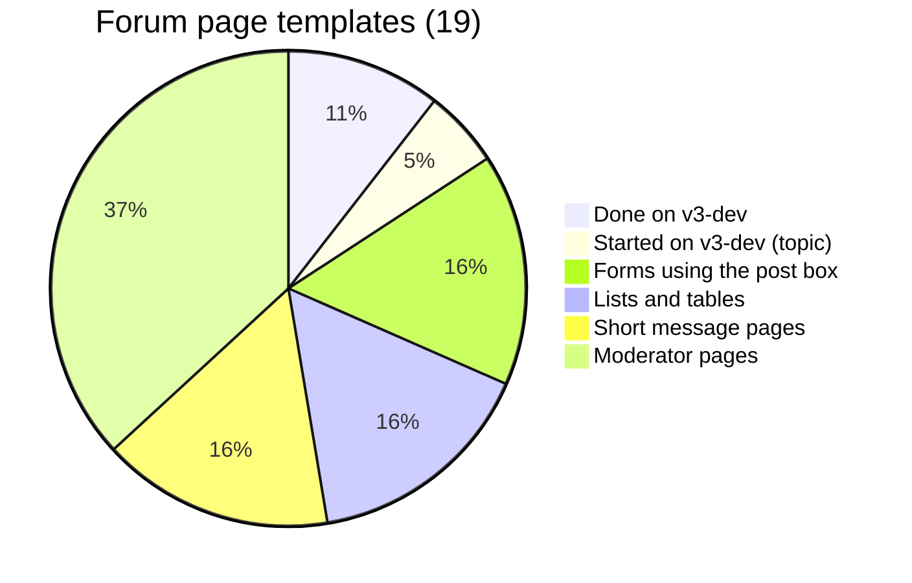

# What the `v3-dev` branch finished for the forums

Researched 2026-10-10. The question: which forum pages were converted to V3 on
`v3-dev`, so the remaining work can be sized.

Sources: `git ls-tree`/`git show v3-dev:...`, the five forum commits on the
branch, and `forums/urls.py` and `forums/views/*.py` on `modernize`. A
template counts as converted if it extends `v3/base.html`.

## The branch

Merge base with `modernize` is `67a7aa42` (2018-01-01). Forum work, in order:

| Commit | Date | Message | What it did |
|---|---|---|---|
| `d8ec4821` | 2017-02-07 | Converting forums to V3 design. | forum index and forum pages, plus their fragments |
| `cafc1361` | 2017-04-12 | WIP forum to V3 design commit. | topic page, new `display_post_v3.html`, Sass |
| `4071a09d` | 2017-04-18 | More forum thread tweaking WIP. | topic page and post display adjustments |
| `323e4bb2` | 2017-08-20 | More V3 forums tweaking. | quick reply and video attachments restyled in `forums.js` |
| `75592992` | 2017-08-27 | V3 forums: forgot to commit new post form template. | `new_post_form.html` |

**Correction to `rough-idea.md`:** "too stale to rebase" overstated it.
Since the merge base, `modernize` changed only **26 lines** across the forum
templates and `forums.js` (the 53-file figure was mostly Python). The branch's
templates are close to usable as they stand. They need the Django 1.x idioms
updated (``, `is_authenticated()` called as a
method) and the `V3_DESIGN` context flag reconsidered.

## Page by page

`forums/urls.py` has 40 routes. 21 render a page; the rest redirect, take a
POST, or answer AJAX. The 21 pages use **19 templates**.

### Converted on `v3-dev`: 3 templates, 3 URLs

| URL | Template | State |
|---|---|---|
| `/forums/` | `index.html` | done |
| `/forums/forum/<slug>/` | `forum_index.html` | done |
| `/forums/topic/<id>/` | `topic.html` + `display_post_v3.html` + `new_post_form.html` | **work in progress** |

The fragments the first two pages use were converted along with them:
`forum_query`, `jump_box`, `navigation_tag`, `topic_icons_tag`,
`last_post_info`, `forum_stats_tag`, and four shared ones outside forums
(`accounts/user_stats_tag`, `bio/member_flags_tag`, `core/max_users_tag`,
`core/whos_online_tag`). Those four may be used by other pages too, which
needs checking before porting.

### What the topic page still lacks

`display_post_v3.html` (59 lines) lays out the author card and post body.
Compared with the current `display_post.html` it has none of these:

- **The post anchor** (`id="post-N"`, `<a name="pN">`), so links to a single
  post (`goto_post`, the permalinks) would land at the top of the page.
- **The per-post tools:** quote-reply, edit, flag, delete, and the moderator's
  stranger and spammer buttons.
- **Attachments** (the video embeds), the **signature**, and **"Last
  edited"**.
- **PM and email links** for the author, and the **stranger** highlight.
- The **link from the IP address** to `post_ip`.

The page itself is otherwise complete: the reply button, pagination,
favorite and subscribe buttons, jump box, moderator controls, and the reply
form using the shared post box. It still loads jQuery UI.

### Not converted: 16 templates, 18 URLs

| Template (lines) | URLs | Kind |
|---|---|---|
| `new_topic.html` (15) | `forum/<slug>/new-topic/` | post box form |
| `new_post.html` (26) | `post/new/<id>/` | post box form, takes `?quote=` |
| `edit_post.html` (22) | `edit/<id>/` | post box form |
| `new_topic_thanks.html` | `new-topic-success/<id>` | message |
| `topic_list.html` (67) | `unread/`, `unanswered/`, `topic/active/<n>/` | topic table |
| `post_list.html` (31) | `my-posts/`, `posts/<user>/` | post list |
| `manage_topics.html` (62) | `favorites/`, `subscriptions/` | topic table with checkboxes |
| `favorite_status.html` | `favorites/<id>/` | message |
| `subscription_status.html` | `subscriptions/<id>/` | message |
| `mod_forum.html` (64) | `mod/forum/<slug>/` | moderator, bulk actions |
| `mod_split_topic.html` (46) | `mod/topic/split/<id>/` | moderator |
| `move_topic.html` (16) | `mod/topic/move/<id>/` | moderator |
| `post_ip.html` | `post/ip/<id>/` | moderator |
| `stranger.html` (32) | `stranger/<id>/` | moderator |
| `spammer.html` (30) | `spammer/<id>/` | moderator |
| `spammer_nailed.html` | `spammer/nailed/<id>/` | moderator |

## Sizing

- **The hardest page is mostly done.** The topic page is the busiest and most
  complex, and it is mostly built. The work left there is the post tools and
  attachments, which is also where the JavaScript (flag, delete, quick reply,
  video attachments) lives.
- **The three forms are small**, but they are where #9 and #16 land. They are
  all the post box, so they get smileys and images from the shared editor.
- **The rest is template work and short.** All 16 unconverted templates add up
  to about 470 lines on the old design. Seven are moderator-only and four are
  one-paragraph messages.
- **JavaScript involved:** `forums/static/js/forums.js` (quick reply, flag,
  delete, video attachments, all jQuery), `forums_mod.js`,
  `templates/forums/forum_query.js` and `jump_box.js`, and markItUp/jQuery UI
  on the three form pages.
