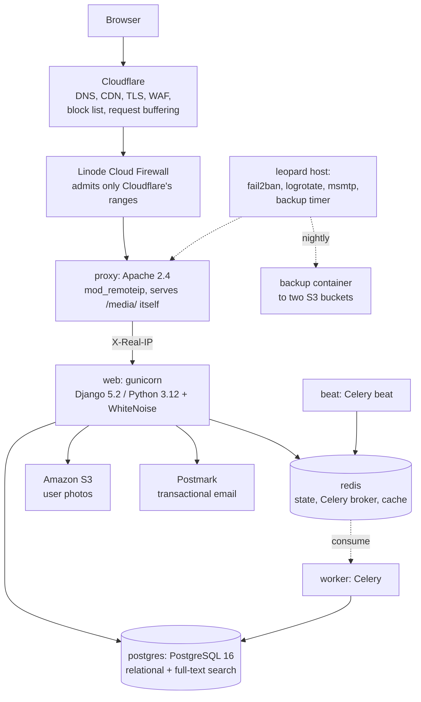
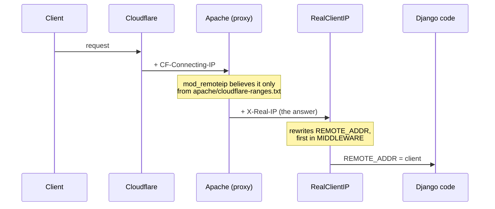
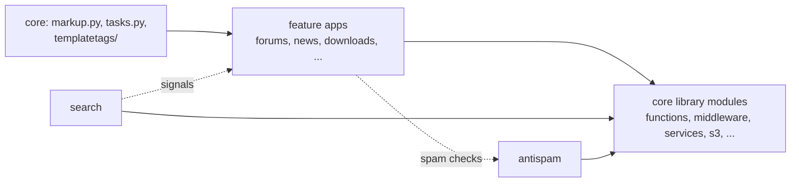
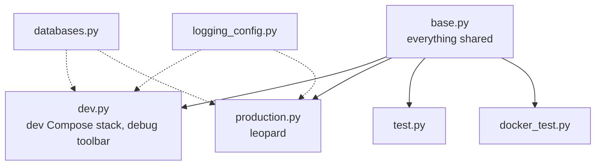
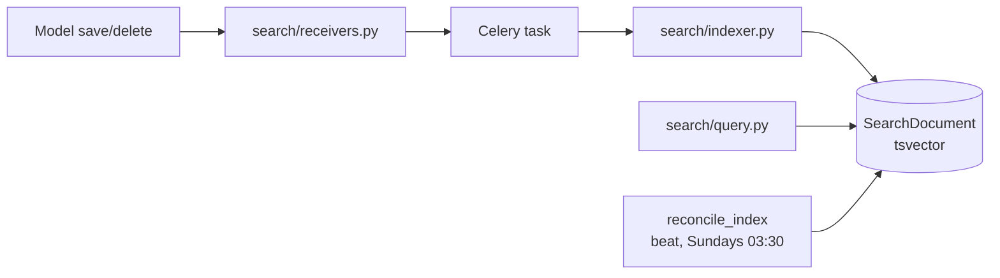

# Architecture

**Generated 2026-10-21.**

## Production's runtime shape

Every box under Cloudflare is a service in `docker-compose.prod.yml`, except the
firewall (the hosting provider's) and the host's own daemons. `backup` is
profile-gated and run by a host timer, never by `up`.

## The client IP takes two hops — load-bearing and easy to miss

Every `REMOTE_ADDR` reader — `antispam`, `accounts`, `forums`, `comments`,
`downloads`, `donations` — is correct only because of this chain:

`core.middleware.RealClientIP` is first in production's `MIDDLEWARE`
(`sg101/settings/production.py`), ahead of `SecurityMiddleware`, so nothing
downstream needs to know. Read the address with `core.functions.get_ip`, never
`X-Forwarded-For`, which any client can forge. The same ranges file feeds the
origin firewall (`make firewall-plan`), and `make cloudflare-ranges-check`
compares it with Cloudflare's published lists.

## Slow uploads are absorbed at the edge, not here

gunicorn's sync workers read the request body themselves and are killed after
30 s; Apache passes the body through as it arrives. A Cloudflare Configuration
Rule, *Buffer request bodies before origin*, makes Cloudflare hold every `POST`
until it is complete. It exists only in the Cloudflare dashboard. Without it a
slow upload returns `502` with a `WORKER TIMEOUT` in `web`'s logs.

## Dependency direction

`core` is the shared kernel, importable by anything. **Its library modules
import no app** — `functions.py`, `middleware.py`, `services.py`, `s3.py`,
`html.py`, `storage.py`, `mail_backends.py`, `paginator.py`, `whos_online.py`,
`download.py`, `email_categories.py` — and new code in `core` should keep that
shape. **Four modules do import apps, and always have**: `markup.py` imports
`smiley` (since 2015), `tasks.py` imports `accounts` inside a function, and
`templatetags/core_tags.py` and `custom_admin_tags.py` import models from
`bio`, `comments`, `downloads`, `forums`, `gcalendar`, `news` and `weblinks`.
Earlier documentation called `core` import-free outright; it was not.

**`antispam` has two shapes inside it.** `antispam/utils.py` reaches into `bio`,
`comments`, `forums` and `user_photos`, so importing it drags four app graphs
along. `antispam/decorators.py` and `antispam/turnstile.py` are deliberately
narrow — stdlib and settings only — so form modules can use them without that.
Follow the narrow shape when adding something with callers in several apps.

## Settings

**One module per deployment.** `manage.py` and `sg101/celery.py` default to
`sg101.settings.dev`; the production image and compose file set
`sg101.settings.production`. `base.py` defines neither `DATABASES` nor
`LOGGING`: each module above `base.py` builds its own from `databases.py` and
`logging_config.py` (the diagram shows only the two deployments' arrows).

**12-factor.** Every setting reads the environment through `django-environ`.
`.env` is git-ignored and loaded by Compose; `.env.example` is committed and is
what CI seeds itself from. Host-side credentials (backup, Cloudflare,
logrotate's heartbeat) live in `secrets/` on leopard, also git-ignored.

## What production adds over base

`production.py`: `RealClientIP` and WhiteNoise in `MIDDLEWARE`;
`SECURE_PROXY_SSL_HEADER`, because Apache terminates the origin TLS and
reaches gunicorn over plain HTTP; HSTS at one week; Redis as the cache (db 2);
`core.storage.ManifestStaticFilesStorage`; S3 for user photos; and the
production logging target (see `interfaces.md`).

## Static files

`collectstatic` runs during the image build, so the manifest cannot disagree
with the code it was built from. WhiteNoise serves the result from the
application process. **`core.storage.ManifestStaticFilesStorage` also hashes
the names JavaScript modules import each other by** — without it a deploy could
leave a browser running a new module against an old one. Django rewrites an
`import … from '…'` only when a semicolon ends the statement;
`core/tests/test_storage.py` checks the site's modules for that.

Apache serves `/media/`, `/photos/` and `/hosted/` from disk itself, and
everything else goes to `web:8000`.

## Search

Native PostgreSQL full-text search, replacing a Xapian/Haystack stack that had
been disabled for years.

Eight document types over one index. Maintenance is incremental via signals
through Celery, and a weekly sweep reconciles drift rather than assuming the
signals never miss. A save that changes nothing searchable does not reindex.

## Content rendering

Markdown renders **at save time**, not per request, into a sibling field:
`UserProfile.profile_text` → `profile_html`, `Post.body` → `html`. Changing how
a field renders therefore needs a data migration to re-render existing rows — a
template change alone will not do it. Rendering lives in `core/markup.py`, with
the site's Markdown extensions in `core/mdexts/`.

## Moderation

`downloads`, `weblinks` and `news` use **split models rather than a boolean
flag**: a `*Base` model subclassed into a `Pending*` model and the live public
model (`DownloadBase` → `PendingDownload` / `Download`), each with its own
manager. Extend that pattern rather than adding an `is_approved` field.
