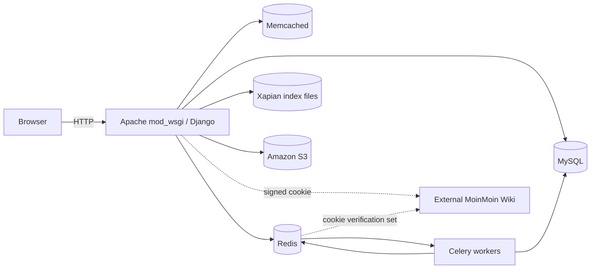
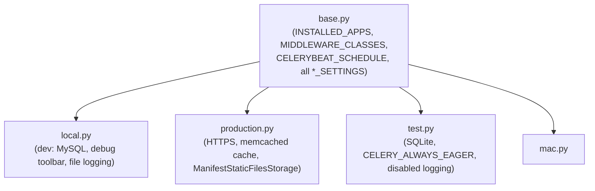

# Architecture

## Overall shape

sg101 is a monolithic Django application: one WSGI process serves all
apps, backed by MySQL, with Redis + Celery handling anything asynchronous.
There is no separate API service or SPA frontend — views render Django
templates server-side (`sg101/templates/` plus each app's own
`templates/<app>/` directory, loaded via `APP_DIRS: True`).

## Settings module hierarchy

`sg101/settings/base.py` holds all shared settings. Environment-specific
files import `*` from it and override:

`manage.py` hardcodes `DJANGO_SETTINGS_MODULE=sg101.settings.local` as the
default; other environments set `DJANGO_SETTINGS_MODULE` explicitly (see
`fabfile.py`'s `collectstatic` task using `--settings=sg101.settings.production`).

All settings files require `sg101/settings/secrets.json` to exist (loaded
in `base.py` via `SECRETS = json.load(...)`) — it is not checked into
version control (`.hgignore`). It supplies `SECRET_KEY`, DB credentials,
AWS keys, Google OAuth client id/secret, and the reCAPTCHA keys.

## App conventions

Nearly every app follows the same internal file layout:

| File | Purpose |
|---|---|
| `models.py` | Django models, often with a custom `Manager` exposing a `public_objects`-style queryset for moderated/public content |
| `views.py` | Function- or class-based views |
| `urls.py` | App-local URL patterns, included from `sg101/urls.py` under a path prefix |
| `admin.py` | `ModelAdmin` registrations |
| `forms.py` | `ModelForm`/`Form` subclasses |
| `receivers.py` | Django signal handlers, connected via the app's `AppConfig.ready()` (see `apps.py` where present) |
| `search_indexes.py` | Haystack `SearchIndex` classes for full-text search |
| `tasks.py` | Celery `@shared_task` functions |

Apps that pre-date Django 1.7's `AppConfig` (no `apps.py`) connect signals
in a `receivers.py` imported directly instead.

## Cross-cutting patterns

- **Public/pending moderation split**: several content apps (`downloads`,
  `weblinks`, `news`) split a base model (`DownloadBase`, `LinkBase`,
  `StoryBase`) into a `Pending*` variant awaiting moderation and the live
  public model, rather than a boolean flag on one table.
- **Signal-driven decoupling**: apps avoid importing each other directly
  in `models.py`; instead cross-app reactions (search indexing, spam
  logging, wiki cookie issuance) are wired up in `receivers.py`/signal
  handler modules. `custom_search/receivers.py` is the best example —
  it centralizes which models feed the search index and under what
  conditions (e.g., only if `is_public`).
- **Async via a job queue, not just Celery**: two different async
  mechanisms coexist — Celery (via `kombu`, broker on Redis) for
  scheduled/background tasks, and the separate `queues` /
  `queued_search` packages (also Redis-backed) specifically for
  batching search-index updates so a spike in edits doesn't hammer
  Xapian synchronously.
- **`core` app as shared kernel**: cross-app utilities live in `core`
  (S3 wrapper, Redis connection helper, Who's-Online tracking, custom
  middleware, Markdown rendering, pagination, a `FixedView` for static
  content pages). Most other apps depend on `core`; `core` depends on
  none of them.
- **External wiki bridge**: the `wiki` app has no models — it exists
  purely to mint a signed cookie (`wiki/middleware.py`) that a separate
  MoinMoin wiki application (outside this repo) validates, with the set
  of valid cookie hashes maintained in Redis.

## Naming gotcha

The `messages` app (private user-to-user messaging) shares its name with
`django.contrib.messages`. This is resolved in `sg101/apps.py` via
`DjangoMessagesConfig`, which relabels the built-in app to
`django_messages` so both can coexist in `INSTALLED_APPS`.
