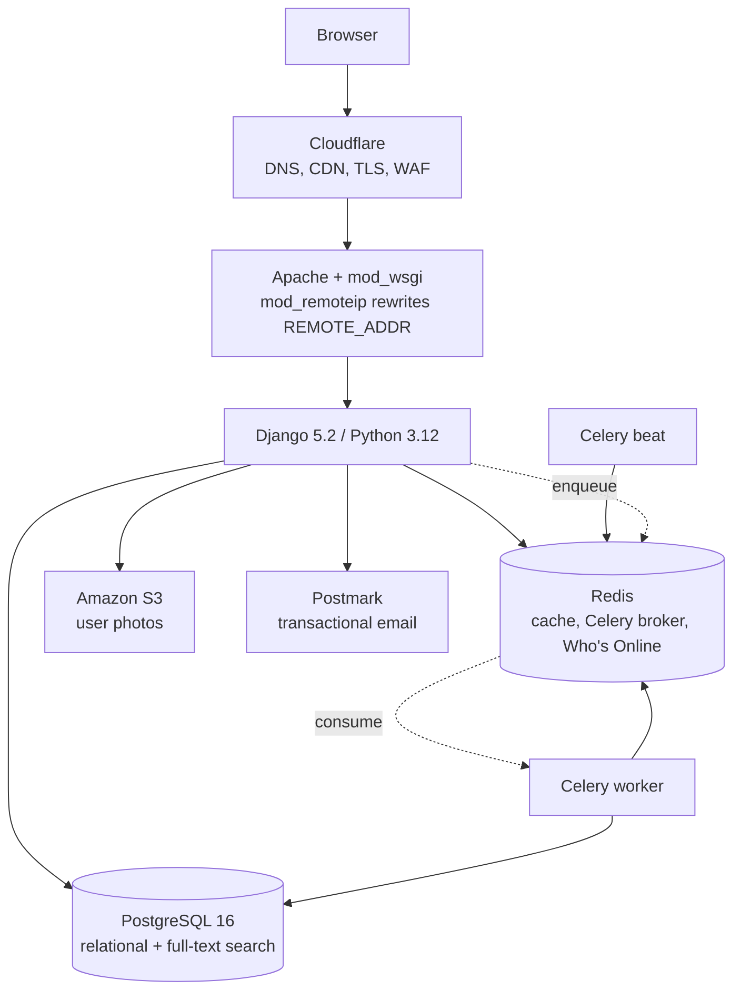
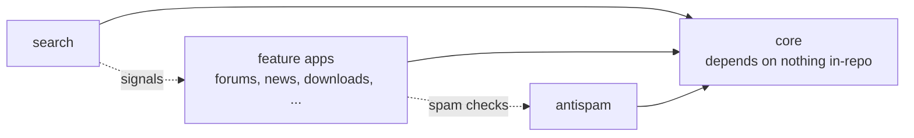
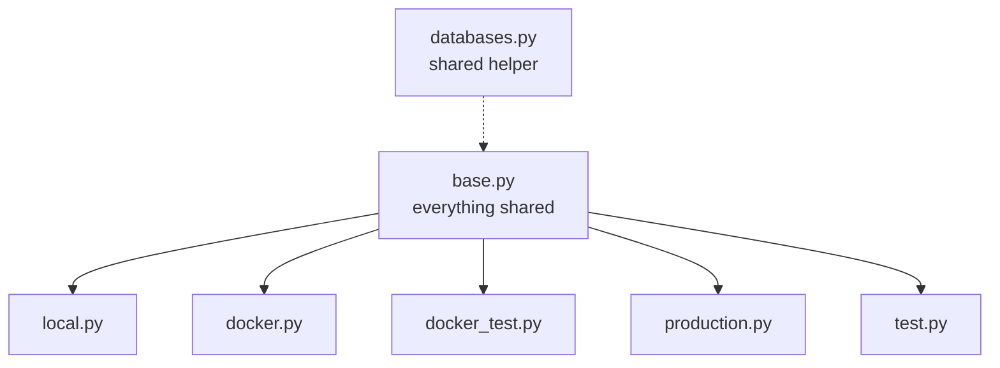

# Architecture

**Generated 2026-08-27.**

## Runtime shape

**`mod_remoteip` is load-bearing and easy to miss.** Every `REMOTE_ADDR` reader
in the codebase — `antispam`, `accounts`, `forums`, `comments`, `downloads`,
`donations` — is correct only because Apache rewrites it from `CF-Connecting-IP`
for Cloudflare's ranges. Nothing in the repo performs that rewrite and Django
does not do it itself. `core.functions.get_ip` documents this deliberately and
reads `REMOTE_ADDR` only, never `X-Forwarded-For`, which any client can forge.

## Dependency direction

`core` is the shared kernel: importable by anything, importing nothing from the
repo. Treat that as an invariant — it is what keeps the app graph acyclic.

**`antispam` has two shapes inside it.** `antispam/utils.py` reaches into `bio`,
`comments`, `forums` and `user_photos`, so importing it drags four app graphs
along. `antispam/decorators.py` and `antispam/turnstile.py` are deliberately
narrow — stdlib and settings only — so form modules can use them without that.
Follow the narrow shape when adding something with callers in several apps.

## Search

Native PostgreSQL full-text search, built in Step 12 to replace a
Xapian/Haystack stack that had been disabled for years and was removed wholesale
in Step 4.

Eight document types over one index. Maintenance is incremental via signals
through Celery, and a weekly sweep reconciles drift rather than assuming the
signals never miss.

## Settings

**12-factor since Step 3.** Every setting reads the environment through
`django-environ`. `.env` is git-ignored and loaded by Compose via `env_file:`;
`.env.example` is committed and is what CI seeds itself from. **There is no
`secrets.json`** — retired in Step 3, and any doc mentioning it is stale.

`manage.py` defaults to `sg101.settings.local`.

## Content rendering

Markdown renders **at save time**, not per request, into a sibling field:
`UserProfile.profile_text` → `profile_html`, `Post.body` → `html`. Changing how
a field renders therefore needs a data migration to re-render existing rows — a
template change alone will not do it. Rendering lives in `core/markup.py`.

## Moderation

`downloads`, `weblinks` and `news` use **split models rather than a boolean
flag**: a `*Base` model subclassed into a `Pending*` model and the live public
model (`DownloadBase` → `PendingDownload` / `Download`), each with its own
manager. Extend that pattern rather than adding an `is_approved` field.
