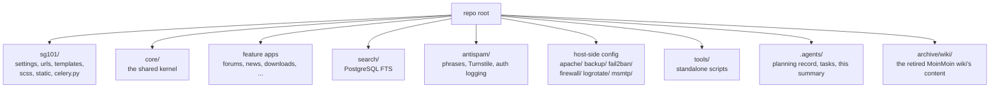

# Codebase Information

**Generated 2026-10-21.** Supersedes the 2026-08-27 generation, which described
the codebase before the Step 21 cutover: jaguar's Apache + `mod_wsgi`, CI on
`modernize` only, and a deployment that had not yet happened.

## What this is

The Django application behind [SurfGuitar101.com](https://www.surfguitar101.com/),
a community site for instrumental surf music: forums, news, a podcast, photo of
the day, downloads, weblinks, a band map, private messaging, polls, contests,
donations, and an event calendar.

## Stack

| | |
|---|---|
| Language | Python 3.12 (`Dockerfile`) |
| Framework | Django 5.2 LTS |
| Application server | gunicorn, sync workers, behind Apache in its own container |
| Database | PostgreSQL 16 |
| Cache / broker | Redis — three databases: site state, Celery broker, cache |
| Async | Celery 5.6 (worker + beat) |
| Search | **PostgreSQL native full-text search** — no Haystack, no Xapian, no third-party search package |
| Static files | WhiteNoise, from a manifest built into the image |
| Object storage | Amazon S3 via boto3 (user photos, backups) |
| Front end | Foundation 6 Sass (`sg101/scss/`), jQuery 3.7.1, the post box as ES modules |
| Config | `django-environ`; every setting reads from the environment |
| VCS | **git**; `main` is deployed |
| CI | GitHub Actions on every branch push and on PRs to `main` |
| Production | Docker Compose on leopard (Linode), behind Cloudflare |

## Repository layout

Every app directory is a Django app on the standard
`models.py` / `views.py` / `urls.py` / `admin.py` / `forms.py` layout. The Django
*project* package is `sg101/`, not to be confused with the repo root.

- `sg101/settings/` — `base.py` holds everything shared. One module per
  deployment: `dev.py` (the dev Compose stack), `production.py` (leopard),
  plus `test.py` and `docker_test.py`. `databases.py` and `logging_config.py`
  are shared helpers, not settings modules.
- `core/` — imported by anything, imports nothing else in the repo.
- `apache/`, `backup/`, `fail2ban/`, `firewall/`, `logrotate/`, `msmtp/` —
  production's host and proxy configuration, versioned with the code. See
  `components.md`.
- `Makefile` — the everyday commands for both stacks; `make help` lists them.
- `tools/` — standalone scripts, run directly rather than via `manage.py`.
- `var/`, `secrets/` — git-ignored; on leopard they hold logs and credentials.

## The apps

`INSTALLED_APPS`, project apps only: `accounts`, `antispam`, `bandmap`,
`banners`, `bio`, `bulletins`, `comments`, `contact`, `contests`, `core`,
`countdown`, `donations`, `downloads`, `elsewhere`, `forums`, `gcalendar`,
`messages`, `news`, `oembed`, `podcast`, `polls`, `potd`, `search`,
`shoutbox`, `smiley`, `user_photos`, `weblinks`, `ygroup`.

**Removed since the last generation, and still present as untracked
directories in an old checkout:** `wiki` (the MoinMoin auth bridge; its content
is under `archive/wiki/`) and `tagging` (the vendored django-tagging; news tags
are a PostgreSQL array now). Neither is in `INSTALLED_APPS`, and git tracks no
file in either directory. **`snapshots/` is not an app**: it holds the
database snapshots `make snapshot` writes, and git tracks only its `.gitkeep`.

## Project status

The modernization is complete and live; `.agents/planning/2026-07-04-modernizing-sg101/STATUS.md`
records what remains open from it. Later work has its own planning projects
under `.agents/planning/` (for example `2026-10-10-v3-forums-and-js`).
