# Codebase Info: SurfGuitar101 (sg101)

## What this is

The Django web application that powers **SurfGuitar101.com**, a community site
for fans of instrumental surf music. It provides discussion forums, a news
section, a podcast feed, a "photo of the day" (POTD) feature, a surf band
database ("band map"), download library, weblink directory, private
messaging, a shoutbox, polls, contests, donations, an event calendar, and a
member map — all glued together by a shared `core` app.

## Language & framework

- **Python 2** (uses `iteritems()`, old-style `super(Class, self)` calls,
  `unicode` literals) — this is a Django **1.8** codebase, pre-dating
  Python 3 support in Django.
- **Django 1.8.15**, using the old-style `MIDDLEWARE_CLASSES` list (not the
  modern `MIDDLEWARE` setting) and function-based middleware classes
  (`process_view` / `process_response`, no `__init__(get_response)`).
- Version control is **Mercurial** (`.hg`), not Git — the `fabfile.py`
  deploy tasks use `hg pull --update`.

## Repository layout

Each top-level directory is a Django "app" (`INSTALLED_APPS` in
`sg101/settings/base.py`), following the standard `models.py` / `views.py`
/ `urls.py` / `admin.py` convention. The Django project package itself is
`sg101/` (settings, root `urls.py`, WSGI/celery entry points).

```mermaid
graph TB
    subgraph Project
        sg101p["sg101/ (settings, root urls, celery app)"]
    end

    subgraph "Content & Community Apps"
        forums["forums"]
        news["news"]
        bio["bio (user profiles/badges)"]
        bulletins["bulletins"]
        comments["comments"]
        shoutbox["shoutbox"]
        messages["messages (private messaging)"]
        polls["polls"]
        contests["contests"]
        wiki["wiki (external MoinMoin bridge)"]
        ygroup["ygroup (archived Yahoo Group posts)"]
        legacy["legacy (phpBB migration data)"]
    end

    subgraph "Media & Surf-specific Apps"
        podcast["podcast"]
        potd["potd (photo of the day)"]
        downloads["downloads"]
        weblinks["weblinks"]
        bandmap["bandmap"]
        membermap["membermap"]
        user_photos["user_photos"]
        gcalendar["gcalendar (Google Calendar)"]
        oembed["oembed"]
        smiley["smiley"]
    end

    subgraph "Platform / Cross-cutting Apps"
        core["core (shared services, middleware, S3, tasks)"]
        accounts["accounts"]
        antispam["antispam"]
        custom_search["custom_search (Haystack glue)"]
        banners["banners"]
        countdown["countdown"]
        contact["contact"]
        donations["donations"]
        irc["irc"]
    end

    sg101p --> core
    core --> forums
    core --> news
    core --> bio
    core --> podcast
    core --> potd
    core --> downloads
    core --> weblinks
    core --> accounts
    core --> antispam
    core --> custom_search
```

## Third-party service integrations

- **MySQL** (production/local) / **SQLite** (test settings) — relational DB
- **Redis** — Who's-Online tracking, the `queues`/`queued_search` async job
  backend, and the Celery broker
- **Celery** — scheduled/background jobs (`sg101/celery.py`,
  `CELERYBEAT_SCHEDULE` in `settings/base.py`)
- **Xapian** (via `django-haystack` + `xapian-haystack`) — full text search
- **Amazon S3** (via `boto`) — user photo storage (`user_photos`,
  `core/s3.py`)
- **Google APIs** — Calendar integration (`gcalendar`, OAuth2 via
  `google-api-python-client`)
- **PayPal** — `donations` app processes IPN callbacks
- **MoinMoin wiki** — external app, bridged via signed cookies
  (`wiki/middleware.py`) and a shared Redis set
- **reCAPTCHA** — spam prevention (`antispam`, settings `RECAPTCHA_*`)
- **fail2ban** — reads the `auth` logger populated by
  `antispam/receivers.py` login signal handlers

## Where to look next

See `.agents/summary/index.md` for a guided tour of the rest of the
generated documentation.
