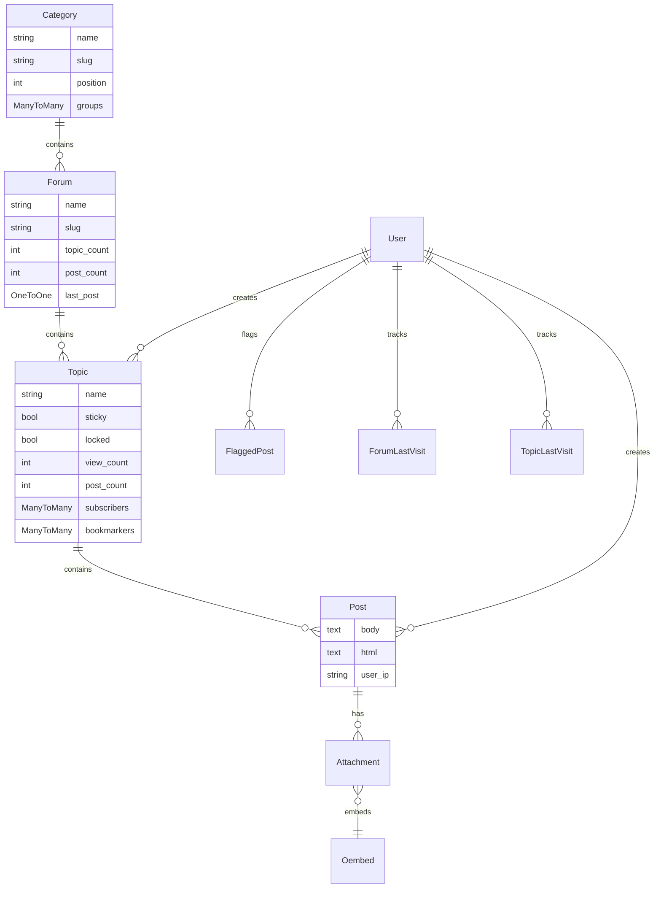
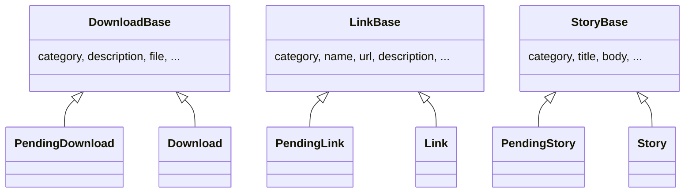

# Data Models

All models are standard Django ORM models (MySQL in production/dev,
SQLite for tests). `django.contrib.auth.User` is the central identity —
almost every content model has a `ForeignKey(User)`.

## Forums (the core content hierarchy)

`Forum`/`Topic` denormalize `topic_count`/`post_count` and `last_post`
for list-page performance rather than aggregating on every request.
`ForumLastVisit`/`TopicLastVisit` back the unread-post feature
(`forums/unread.py`); `core.tasks.cleanup` periodically deletes stale
visit records via the `forum_cleanup` management command.

## User profile (`bio`)

`UserProfile` is a `OneToOneField(User)` extension holding site-specific
profile data: location/country/birthday/occupation/interests, rendered
Markdown profile text and forum signature (stored as both raw and
pre-rendered `_html` fields — see the Markdown rendering note in
[workflows.md](workflows.md)), avatar image, timezone/24h-time
preferences, denormalized `forum_post_count`, a `status` enum, and a
`badges` M2M through `BadgeOwnership`. `UserProfileFlag` supports
user-to-user reporting.

## Pending/public moderation pattern

Three unrelated apps share the same modeling idiom: an abstract-ish base
class with common fields, subclassed into a `Pending*` model (awaiting
moderator approval) and the live public model.

`Download`, `Link`, and `Story` additionally expose a `public_objects`-style
manager (`PublicDownloadManager`, `PublicLinkManager`,
`PublicContestManager` for `contests.Contest`) that filters to
publish-ready rows — used by `custom_search`'s indexing logic and by
public-facing list views. `FlaggedLink`/`FlaggedPost`/`ShoutFlag`/`CommentFlag`
are the moderation-report counterparts across different apps (no shared
base class — each app defines its own).

## Other notable models

- **`accounts`**: `PendingUser` (registration awaiting email
  confirmation), `IllegalUsername`/`IllegalEmail` (registration
  blocklists).
- **`messages`**: `Message`, per-user `Options`, and `Flag`
  (read/deleted state per message per user).
- **`podcast`**: `Channel` → `Item` (one channel, many episodes).
- **`potd`**: `Photo` (the pool), `Current` (today's pick, one row),
  `Sequence` (controls rotation order) — see the `pick_potd` Celery task
  in [workflows.md](workflows.md).
- **`polls`**: `Poll` → `Choice`.
- **`gcalendar`**: `Event` with a `PendingEventManager` (mirrors the
  pending/public split for calendar submissions).
- **`ygroup`**: `Thread` → `Post`, a frozen archive imported from the
  site's former Yahoo Group (see `tools/load_ygroup.py`).
- **`oembed`**: `Provider` (known oEmbed providers) and `Oembed` (cached
  responses, referenced by `forums.Attachment`).
- **`banners`**: `Campaign` → `Banner`.
- **`membermap`/`bandmap`**: `MapEntry` / `BandEntry` — geolocated
  entries, no relation to each other despite similar shape.

## Fields that store rendered HTML alongside source

A recurring pattern: a model stores user-authored Markdown/text in one
field and a pre-rendered HTML cache in a sibling `*_html` field (e.g.
`UserProfile.profile_text`/`profile_html`, `UserProfile.signature`/
`signature_html`, `forums.Post.body`/`html`). Rendering happens at
save-time (see `core/markup.py`), trading storage for avoiding
per-request Markdown parsing.
