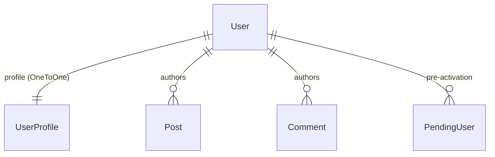
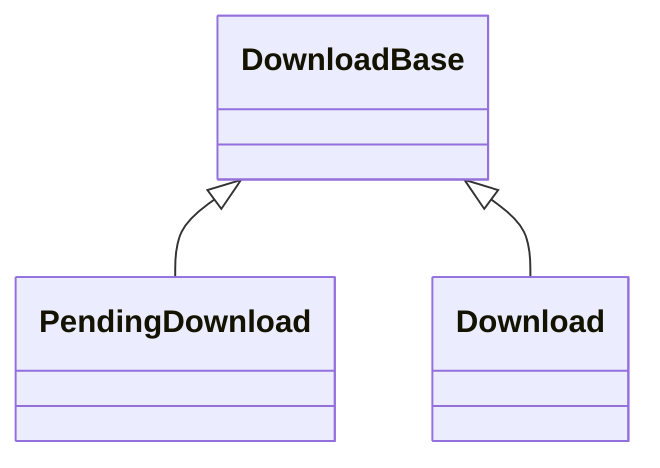

# Data Models

**Generated 2026-08-27.**

## Users

**No custom `AUTH_USER_MODEL`.** `bio.UserProfile` attaches to `auth.User` via
`OneToOneField(User, related_name='profile')`. Profile data lives there, not on
`User`.

`accounts.PendingUser` holds a registration between the form and the emailed
activation link, with a key minted by `secrets` (Step 16 task 08) and compared
with `secrets.compare_digest`.

**`User.email` is not unique.** 26 accounts share an address across 13 groups.
`unique=True` remains a follow-on because those rows would fail the migration —
recorded in `STATUS.md` under Step 16 task 05.

## Moderation — split models, not a flag

Same shape in `weblinks` and `news`. Each concrete model has its own
`public_objects`-style manager. **Extend this rather than adding `is_approved`.**

## Rendered-HTML sibling fields

Markdown source and rendered HTML are stored side by side and rendered at save
time: `UserProfile.profile_text`/`profile_html`, `Post.body`/`html`. A change to
rendering needs a **data migration** to re-render existing rows.

## Search index

`search.SearchDocument` holds a `tsvector` over eight content types, maintained
incrementally by signals through Celery and reconciled weekly. It is derived
data — rebuildable, and never the source of truth.

## Collation caveat

`ORDER BY` results differ between the old MySQL collation and PostgreSQL's.
Audited 2026-08-13 and scheduled into Step 19; see `STATUS.md`. Do not assume
ordering parity with pre-migration behaviour.
