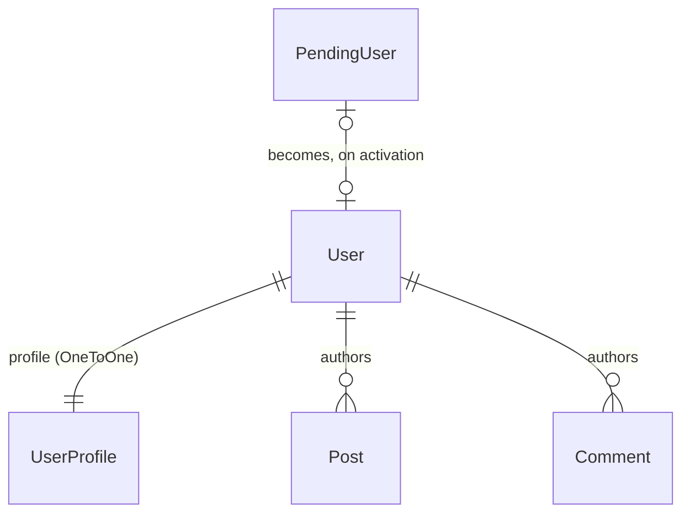
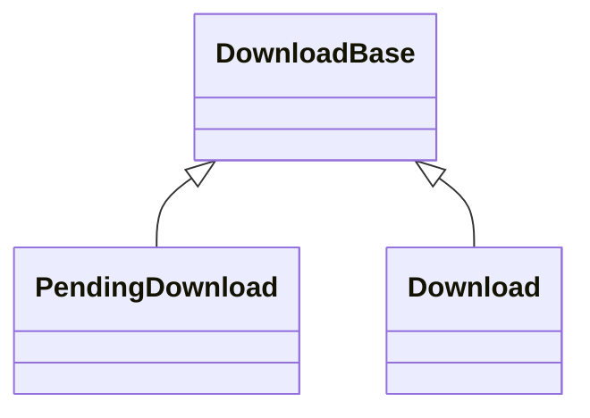

# Data Models

**Generated 2026-10-21.**

## Users

**No custom `AUTH_USER_MODEL`.** `bio.UserProfile` attaches to `auth.User` via
`OneToOneField(User, related_name='profile')`. Profile data lives there, not on
`User`.

`accounts.PendingUser` holds a registration between the form and the emailed
activation link, with a key minted by `secrets` and compared with
`secrets.compare_digest`.

**An email address has one owner.** `accounts/0008` created a unique index on
`LOWER(email) WHERE email <> ''` on `auth_user`, after blanking the losing
address in each duplicate group. The blanked accounts keep their posts and can
still log in; they cannot reset their own password. Code that sets an email
must expect an `IntegrityError` on a case-insensitive duplicate, and `''` is
exempt.

**`UserProfile.status` is a durable record.** `STA_SPAMMER` (4) with
`status_date` is every spam deactivation since 2011, set by
`antispam.utils.deactivate_spammer()`. For spam history it outlasts any log.

## Moderation — split models, not a flag

Same shape in `weblinks` and `news`. Each concrete model has its own
`public_objects`-style manager. **Extend this rather than adding `is_approved`.**

## News tags — an array, not a tagging app

A story's tags are a PostgreSQL `ArrayField` on the story. The vendored
django-tagging app and its generic tables are gone. `manage.py rename_tag` and
`merge_tags` edit tags across stories.

## Rendered-HTML sibling fields

Markdown source and rendered HTML are stored side by side and rendered at save
time: `UserProfile.profile_text`/`profile_html`, `Post.body`/`html`. A change to
rendering needs a **data migration** to re-render existing rows.

## Derived state outside the database

`search.SearchDocument` holds a `tsvector` over eight content types,
maintained incrementally by signals through Celery and reconciled weekly.
`forums` keeps feeds, updated topics and counts in Redis, and `accounts` keeps
the user count and newest members there. **All of it is derived and
rebuildable**: after a database restore, run `manage.py rebuild_redis`,
because Redis otherwise keeps describing the old database under IDs the
restored one reuses.

## Collation

PostgreSQL's ordering differs from the old MySQL collation's. Do not assume
ordering parity with jaguar's behaviour; `STATUS.md` records the audit.
