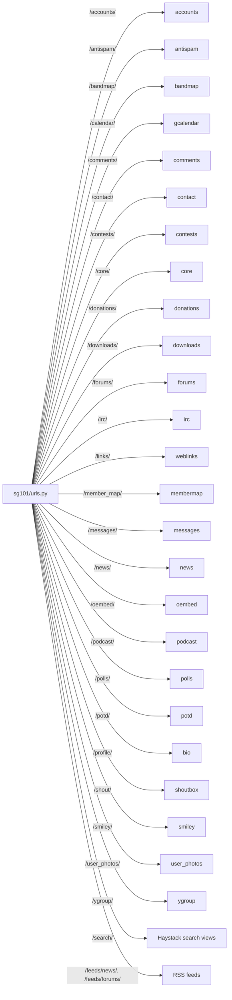

# Interfaces

## URL routing

`sg101/urls.py` is the single root URLconf. It mounts each app's own
`urls.py` under a fixed prefix, plus a handful of routes defined directly
(home page, static "fixed" pages, password reset, Haystack search views,
RSS feeds).

Note the prefix doesn't always match the app name — `bio` is mounted at
`/profile/`, `weblinks` at `/links/`, `gcalendar` at `/calendar/`.

## RSS/Atom feeds

- `/feeds/news/` → `news.feeds.LatestNewsFeed` (cached 6h)
- `/feeds/forums/` and `/feeds/forums/<forum_slug>/` →
  `forums.feeds.ForumsFeed` (cached 5m)

## Full-text search

`/search/` and `/search/ajax/` are Haystack `search_view_factory` views
using `custom_search.forms.CustomModelSearchForm` and
`custom_search.views.UserSearchView`, querying a `SearchQuerySet` ordered
by `-pub_date`. The searchable models are wired up in
`custom_search/receivers.py`: `ygroup.Post`, `weblinks.Link` (if public),
`podcast.Item`, `news.Story`, `downloads.Download` (if public),
`forums.Topic`/`forums.Post` (if in a public forum), `bio.UserProfile`.
Each searchable app has a `search_indexes.py` defining its Haystack
`SearchIndex`.

## External service integrations

| Integration | Module(s) | Notes |
|---|---|---|
| PayPal IPN | `donations/views.py` (`ipn` view, `/donations/ipn/`) | `csrf_exempt` webhook; verifies the postback by re-POSTing to PayPal via `curl` (see `verify_request`). Sandbox vs. live selected by `DONATIONS_DEBUG`. |
| Amazon S3 | `core/s3.py` (`S3Bucket`), used by `user_photos` | Uploads/deletes photos; bucket/keys come from `USER_PHOTOS_*` settings (secrets-backed). |
| Google Calendar + OAuth2 | `gcalendar/oauth.py`, `gcalendar/calendar.py` | Reads/writes a shared Google Calendar (`GCAL_CALENDAR_ID`); credentials cached at `GCAL_CREDENTIALS_PATH`. |
| oEmbed | `oembed/core.py`, `/oembed/fetch/`, `/oembed/fetch_saved/` | Fetches and caches oEmbed metadata (e.g., for embedded YouTube links) so it isn't refetched on every page render. |
| reCAPTCHA | `antispam` (decorator + settings `RECAPTCHA_*`) | Verifies against `https://www.google.com/recaptcha/api/siteverify`. |
| External MoinMoin wiki | `wiki/middleware.py` | Not an HTTP API call — issues a signed cookie (`WIKI_COOKIE_NAME`) and records a verification hash in a Redis set (`WIKI_REDIS_SET`) that the external wiki reads directly. |
| IRC channel roster | `irc/channel.py` | Reads the `irc:channel_members` Redis key to display who's currently in the site's IRC channel; something outside this repo (an IRC bot) is responsible for writing that key. |
| fail2ban | `antispam/receivers.py` → `auth` logger | Not code-level; fail2ban tails `logs/auth.log` for failed-login lines. |

## Admin & docs

- Django admin at `/admin/` (every app registers models via its
  `admin.py`).
- `django.contrib.admindocs` mounted at `/admin/doc/`.

## Celery task interface

See [workflows.md](workflows.md) for the scheduled task list
(`CELERYBEAT_SCHEDULE`) and the two async mechanisms in play.
