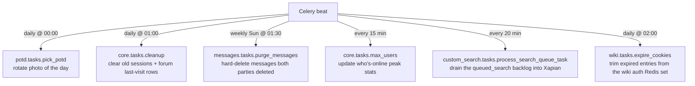
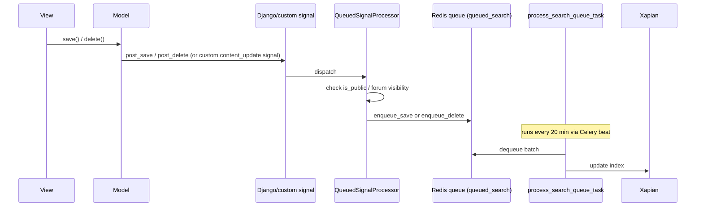
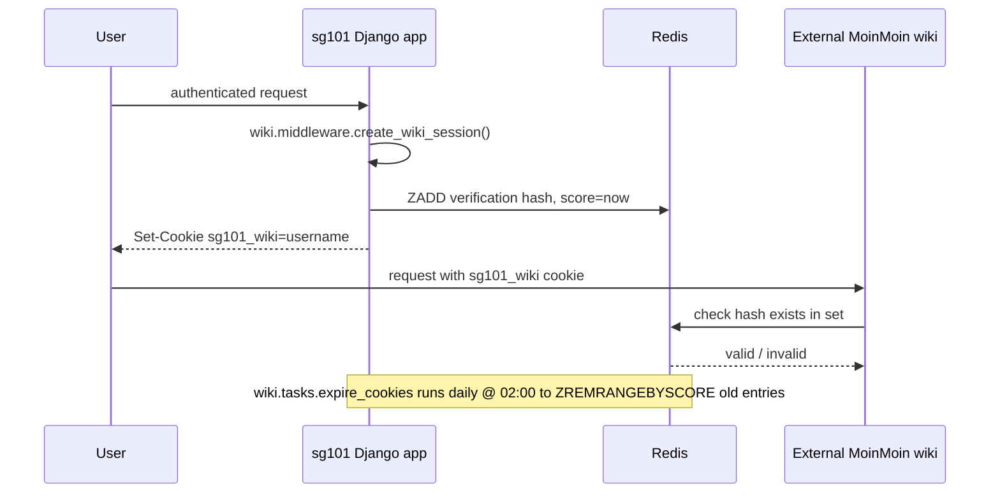

# Workflows

## Scheduled (Celery beat) jobs

Defined in `CELERYBEAT_SCHEDULE` (`sg101/settings/base.py`):

## Two async mechanisms — don't conflate them

1. **Celery** — the scheduled jobs above, plus any one-off
   `@shared_task` calls (e.g. `core.tasks.send_mail`). Broker is Redis
   (`BROKER_URL`), tasks run eagerly/synchronously under
   `sg101/settings/test.py` (`CELERY_ALWAYS_EAGER = True`).
2. **`queues` / `queued_search`** — a separate Redis-backed job queue
   used *specifically* to batch search-index updates
   (`custom_search/receivers.py` enqueues on model save/delete;
   `custom_search.tasks.process_search_queue_task`, itself a Celery
   task run every 20 minutes, drains that queue into Xapian). This
   indirection exists so bulk edits don't trigger synchronous Xapian
   writes on every request. It can be disabled site-wide via
   `SEARCH_QUEUE_ENABLED = False` — useful while rebuilding the search
   index from scratch.

## Search indexing flow

Forum `Topic`/`Post` use custom signals (`topic_content_update`,
`post_content_update` in `forums/signals.py`) instead of plain
`post_save`, because indexability depends on the *parent forum's*
public/private status, not a field on the model itself.

## Moderation / pending-content workflow

`downloads`, `weblinks`, and `news` share the same shape: a user
submission lands in the `Pending*` model; a moderator (via `admin.py` or
an app-specific moderation view) promotes it into the public model
(`Download`, `Link`, `Story`). Only the public model is search-indexed
and shown in public listings (`public_objects` managers). Flagging
(`FlaggedLink`, `FlaggedPost`, `CommentFlag`, `ShoutFlag`) is the inverse
flow — public content gets reported by users and routed to moderators.

## User registration

`accounts.PendingUser` holds a registration until the user confirms via
an emailed link; `IllegalUsername`/`IllegalEmail` blocklists are checked
at registration time before a `PendingUser` is even created.

## Who's-Online tracking

`core.middleware.WhosOnline.process_response` runs on every non-AJAX
response: for an authenticated user it calls `report_user()` at most once
per `ONLINE_TIMEOUT` (5 min, tracked via the `sg101_online` cookie); for
anonymous visitors with cookies enabled it calls `report_visitor(ip)`
instead. `core.tasks.max_users` (every 15 min) rolls this into peak
online/visitor statistics (`core/whos_online.py`).

## External wiki authentication bridge

## PayPal donation flow

`donations` renders a PayPal "Donate" button form (params vary by
`DONATIONS_DEBUG` — sandbox vs. live endpoint). PayPal POSTs an IPN
notification back to `/donations/ipn/` (`csrf_exempt`); the view
re-POSTs the payload back to PayPal (`verify_request`, via `curl`) to
confirm authenticity before recording a `Donation` row. Tests short-circuit
this HTTP round-trip via `settings.DONATIONS_DEBUG_VERIFY_RESPONSE`.

## Deployment (`fabfile.py`)

Fabric tasks run over SSH against the production server:
`update` (`hg pull --update`), `collectstatic` (runs Django's
`collectstatic` with `--settings=sg101.settings.production`), `touch`
(touches the WSGI file to trigger a mod_wsgi reload). There is no CI
pipeline in this repo — deployment is manual via these three Fabric
commands.
