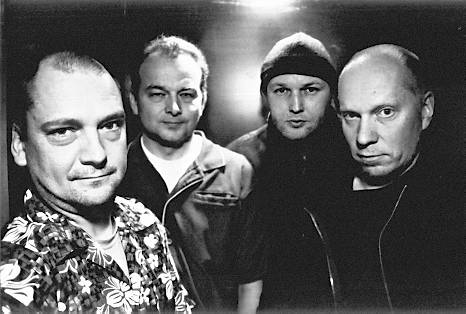

<!-- Archived from wiki.surfguitar101.com (MoinMoin), page "BandDatabase/LaikaAndTheCosmonauts", revision 7.
     Lossless original: archive/wiki/moinmoin/BandDatabase(2f)LaikaAndTheCosmonauts/revisions/00000007 -->

# Laika & The Cosmonauts

**Years active**: 1987 - 2008   
**Location**: Finland

## Biography

Laika & The Cosmonauts started out as a very traditional surf sounding band, with touches of the native Finnish Rautalanka sound. Over the course of their career they formed their own unique movie-soundtrack type style, exemplified by the 2004 release *Local Warming*. The band appeared on European television a dozen times and toured the United States six times, including an opening slot for Ministry.

The band called it quits in 2008 and concluded their 20 year career with a US tour. The last two shows were played at The Continental Club in Austin, Texas.

## Band Members

* Mikko Lankinen, guitar
* Janne Haavisto, drums
* Matti Pitsinki, organ and guitar
* Tom Nyman, bass guitar

## Releases

* C'mon Do The Laika, 1988
* Surfs You Right, 1990
* Surfs You Right / C'mon Do The Laika (a compilation of the first two albums), Castle Finland Oy Ltd., 1990
* Instruments of Terror, Upstart Records, 1992
  1. Mission Impossible
  2. Note Crisis
  3. Piedras Negras
  4. PYSKO (Themes from Psycho and Vertigo)
  5. Magic Bullet
  6. Enchanged Rock
  7. Baha-ree-bah!
  8. S.P.Y.D.A.'s Web
  9. Space Base
  10. Experiment in Terror
  11. Six Seconds in Dallas
  12. Vendetta
  13. Kiiriminna (Oi Dai) (US only)
  14. Marilaulu (US only)
  15. Theme from "Endless Summer" (US only)
* The Amazing Colossal Band, Upstart Records, 1995
  1. Delayrium
  2. Floating
  3. Tantrum
  4. The A-Treatment
  5. The Ipcress File
  6. Global Village
  7. The Avengers
  8. Exposé
  9. Aztec Two-Step
  10. The Downwinders
  11. Café Equator
  12. O.C.C.C. (Oahu Community Correctional Center)
  13. Get Carter
  14. The Man from H.U.A.C.
  15. Azure Blue
  16. Intro (Bonus track from the movie Iron Horse Men)
  17. Skater Dater (Bonus track from the movie Iron Horse Men)
* Zero Gravity (US compilation of the first two albums), 1996
* Absurdistan, Yep Roc Records, 1997
  1. Disconnected
  2. Turquoise
  3. Look! No Head!
  4. The Hypno-Wheel
  5. Boris The Conductor
  6. Lands End
  7. Circumstantial Evidence
  8. The Freefaller
  9. Syncophant
  10. Silenzio
  11. Hi & Lo
  12. Nanaki
  13. Rough Ground
  14. Silenzio in Dubsurdistan
  15. Rough Evidence on Circumstantial Ground
  16. Re-Inventing the Hypno-Wheel
* Laika Sex Machine (live), Yep Roc Records, 2000
  1. The Hypno-Wheel
  2. Disconnected
  3. Syncophant
  4. Tantrum
  5. Floating
  6. Turquoise
  7. Boris The Conductor
  8. Look! No Head!
  9. Experiment In Terror
  10. The Avengers
  11. Circumstantial Evidence
  12. Hi & Lo
  13. Café Equator
  14. Lands End
  15. Psyko (Themes from "Psycho" and "Vertigo")
  16. Mission Impossible
  17. Get Carter
  18. Global Village
  19. Enchanted Rock
  20. C'mon Do The Laika!
  21. Fugitive
  22. Ba-Ha-Ree-Bah!
  23. Fadeaway
  24. Sauna-Soul (Ode to Billy Joe)
  25. Telstar
* Local Warming, Yep Roc Records, 2004
* Cosmopolis, Yep Roc Records, 2008 (Compilation)

## Links

* <http://www.yeproc.com/artists/laika-the-cosmonauts>

---

[CategoryBands](../CategoryBands.md)
