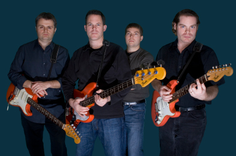

<!-- Archived from wiki.surfguitar101.com (MoinMoin), page "BandDatabase/TheMadeira", revision 3.
     Lossless original: archive/wiki/moinmoin/BandDatabase(2f)TheMadeira/revisions/00000003 -->

# The Madeira

**Years active**: 2004 - present   
**Location**: Indianapolis, Indiana, USA

## Biography

Biography or other band information goes here. Please stick to the facts only.

## Band Members

* Ivan Pongracic, Lead Guitar
* Patrick J. O'Connor, Rhythm Guitar
* Todd Fortier, Bass (2005 - present)
* Dane Carter, Drums
* Scott Waddell, Bass (2004 - 2005)

## Releases

### Full Length

* Tribal Fires, Double Crown Records, March 06, 2012
  1. Tribal Fury
  2. Cities of Gold
  3. Twilight
  4. Fire Sacrifice
  5. The Expedition
  6. Witch Doctor
  7. Jungle Drums
  8. Arcadian Voyage
  9. Mar Vista
  10. Giant
  11. Pre-Ritual
  12. Ritual
  13. Zanzibar
* Carpe Noctem, Double Crown Records, May 27, 2008
  1. Carpe Noctem
  2. Wreak Havoc
  3. Undercurrents
  4. Rolling Thunder
  5. Infidel
  6. El Flaco
  7. Hamsa
  8. The Saracen
  9. SOS (Stomp On Stomp)
  10. Tangaroa
  11. Surf Fidelis
  12. Sahar
  13. End of the Circle
* Sandstorm, Double Crown Records, December 13, 2005
  1. Sun & Sand
  2. Sandstorm!
  3. Cordoba
  4. El Caliph
  5. Burning Mirage
  6. Rogue Wave
  7. The Secret Route
  8. Desert Drums
  9. Ricochet
  10. Crescent Moon
  11. Across the Dunes
  12. Express to Baghdad
  13. The Oasis

### EP's / 7" / Singles

* Ruins, Double Crown Records, August 01, 2006
  1. The Victor
  2. Dilmohammed
  3. Almoraima
  4. Intruder #1
  5. Intruder

### Compilations

* Album 1, Record Label Name, release date
  1. Track 1

## Links

* <http://themadeira.net/>

---

[CategoryBands](../CategoryBands.md)
