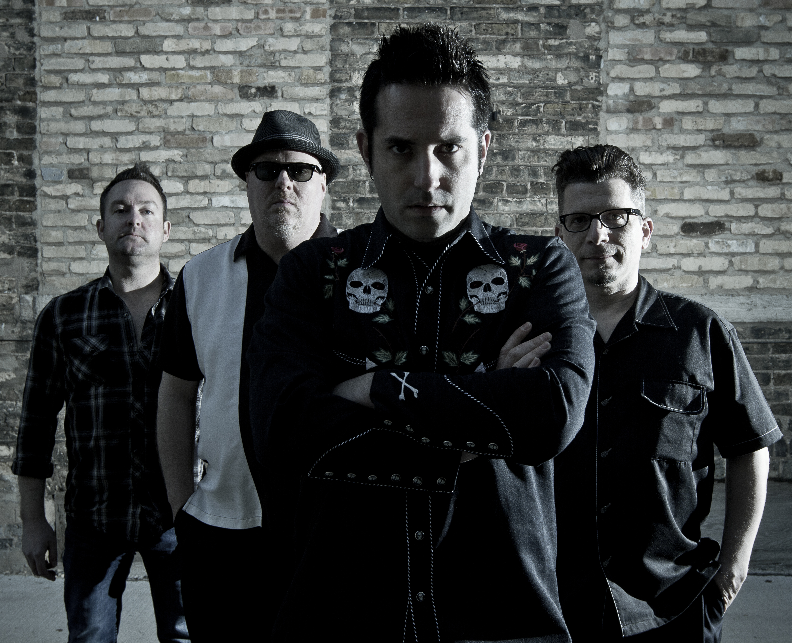

<!-- Archived from wiki.surfguitar101.com (MoinMoin), page "BandDatabase/TheRevomatics", revision 62.
     Lossless original: archive/wiki/moinmoin/BandDatabase(2f)TheRevomatics/revisions/00000062 -->
<!-- The image below replaces a hotlink to therevomatics.com that now 404s.
     The band uploaded this photo as a wiki attachment 154 seconds after the
     page was last saved (2017-08-31) and never linked it in. The markup under
     moinmoin/ is unchanged and still carries the dead hotlink. -->

# The Revomatics

**Years active**: 2010 - Present   
**Location**: Milwaukee, Wisconsin, USA

## Biography

A certain reverence to the past mixed with a heavy dose of contemporary flair defines The Revomatic’s sound. One foot planted in thunderous, reverberating guitars, the other placed firmly in the genre that defined a generation of southern California rebels. The Revomatics have shared the stage with The B-52s, Unknown Hinson, The Madeira and the legendary Dick Dale.

Please contact [info@therevomatics.com](mailto:info@therevomatics.com) for more information.

## Band Members

* Drew De Lutio - Guitar
* Joe Weigel - Guitar
* Pete Flessas - Bass
* Jeff Schneider - Drums

## Releases

### EP's / Vinyl / LP's

* "Racing", Compact Disc LP, July 2012
* "Rev It Up!", Compact Disc LP, June 2013
* "Live at Lucky Joe's Tiki Room", Compact Disc LP, July 2014
* "We Come In Peace", Compact Disc LP, May 2015
* "Hot Rod Strut/Sucker Punch", Vinyl 45, September 2015
* "Continental Magazine #24", Compilation Compact Disc, June 2016
* "Worse Case Scenario", Compilation Compact Disc, July 2017
* "Nocturnica", Compact Disc EP, August 2017

## Video

* <https://www.youtube.com/watch?v=EDiCuTniOGk&list=PL9iZoDHhfanj3IvEQu-R_ryWGWGb-yzXR&index=6>
* <https://www.youtube.com/watch?v=6o4bxzlUY1Q>
* <https://www.youtube.com/watch?v=_rCJE4FOvLY>

## Links

* [Official Site](http://www.therevomatics.com)
* [Facebook](http://www.facebook.com/therevomatics)
* [Reverbnation](http://www.reverbnation.com/therevomatics)
* [Twitter](http://www.twitter.com/TheRevomatics)

---

[CategoryBands](../CategoryBands.md)
