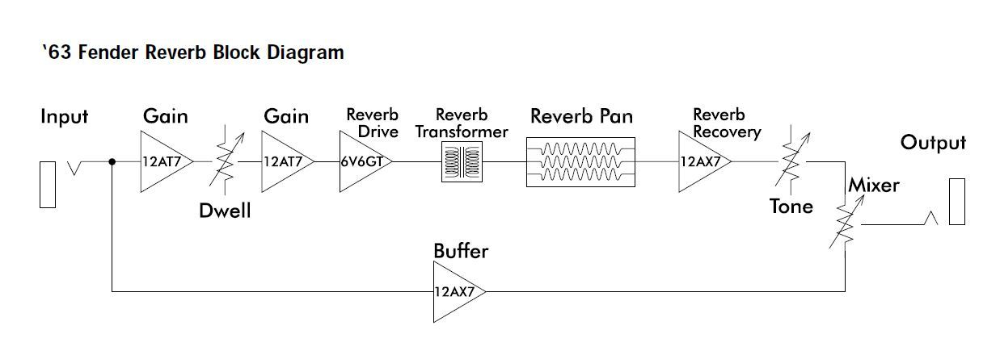

<!-- Archived from wiki.surfguitar101.com (MoinMoin), page "ReverbFaq", revision 54.
     Lossless original: archive/wiki/moinmoin/ReverbFaq/revisions/00000054 -->

# Fender 6G15 Reverb Unit

## General Description

The **Fender Reverb Unit** (6G15) was a tube, spring reverb-equipped effects unit made by [Fender](http://en.wikipedia.org/wiki/Fender_Musical_Instrument_Corporation). The Reverb Unit was originally introduced in 1961. It was discontinued in 1966 and was replaced by a solid-state model, the FR1000.[[http://en.wikipedia.org/wiki/Fender\_Reverb\_Unit#cite\_note-1|[1]]] The unit features three controls: Dwell, Mix and Tone and is run by two pre-amp tubes and a power tube. Physically the unit looks like a small ampilfier head and since the early '60s the unit has become synonymous with surf music.

## Variants

* 1961-1966 - Handwired, 6K6 powertube, Hammond reverb pan (61-64)Gibbs reverb pan(64-66), appeared in every cosmetic variation in that era.
* 1976-1978 - Handwired, 6V6 power tube, Accutronics reverb pan, silverface cosmetics. Super rare, I think somebody here owns one. I've never seen one is person. I think they are just the same as 61-66...
* 1994- Present Reissue - PCB, 6V6 powertube, Accutronics pan, Blonde/oxblood, brown/wheat, black/silver, tweed.

## Theory of Operation

Block diagram from the Fender Owner's Manual, (Fender P/N 047980) Note: Reissue unit depicted with 6V6 tube in lieu of original 6K6, see discussion below.

### Reverb Drive Path

The first stage uses one half of the 12AT7 and provides a voltage gain. A voltage divider reduces the signal and then it is sent to the Dwell control (250K pot), which determines the amount of signal sent to the reverb drive circuit.

The reverb drive circuit consists of the second half of the 12AT7 preamp tube, a high-pass filter, a 6K6 power tube, and the reverb transformer.

The signal is amplified by the 12AT7 and sent through an RC high-pass filter which rolls off low frequencies below 300Hz.

The 6K6GT power tube supplies power necessary to drive the reverb transformer. Although a 6V6 driver tube is used in the 90's reissue, the power tube biasing resistor is the same value used by the 6K6 circuit. This larger value causes the 6V6 to be overbiased (cold), limiting output power and causing early distortion.

### Reverb Recovery Path

The footswitch turns the reverb on and off by grounding the input to the reverb recovery circuit. One half of the 12AX7 tube amplifies the reverb return signal.

The Tone control attenuates the high frequencies ( I can run a PSpice simulation to illustrate the effect of the tone control settings)

### Dry Signal Path

1/2 of the 12AX7 is used as a cathode follower buffer amplifier for the dry signal. The input to the dry signal path is directly in parallel with the reverb drive path!

### Mixer Circuit

The Mixer circuit is a simple resistive mixer consisting of a 250K linear taper pot. One side of the pot is fed by the dry signal path and the other is fed by the reverb recovery circuit. The control is essentially a pan pot that favors the dry signal at 0 and the wet signal when set to 10. This is in contrast to the Reverb control used in the combo amps, which simply controls the amount of reverb recovery signal mixed into the dry signal path.

As the Mixer control is turned up from zero, additional resistance is placed in series with the output of the dry signal path (the cathode follower). This additional resistance forms a low-pass RC filter with the capacitance of the cable used to connect the reverb unit to the amplifier. The resultant filter removes high frequencies from the dry signal, an effect known as 'tone suck'. (PSpice simulations can illustrate the amount of high-frequency loss in the dry signal caused by the Mixer control settings)

### Output Buffer Circuit (70's reissue only)

A 4th preamp tube is added. A cathode follower is used to isolate the Mixer output from the guitar cable/amplifier load imedance. The goal is to prevent tonal variations (tone suck) as the Mixer control is turned up. The buffer prevents the patch cable capacitance from interacting with the Mixer control resistance, mitigating the RC filtering effect.

### Discussion regarding orientation of the reverb pan

Adjunct to the discussion below regarding swap of the pan, orientation of the pan (hanging vertically vs. horizontally in the floor of a combo amp) can influence tonality beyond the convenience aspect of connecting it with the RCA-plugged cables and should be the prime decision-maker in the PN ordered (slightly longer RCA cables can easily be obtained).

It's been pointed out that the difference between the vertical and horizontal reverb tanks has to do with the the "ideal mounting plane" for the tank inside the cabinet. The ideal plane is one that allows the transducer magnet to be centered in the "air gap" between the magnet and the transducer. Tanks made for vertical mount are "the best positioned mechanically to maintain that air gap". Tanks made for horizontal mount have some mechanical compensation added to the magnets position. That is, the magnets in horizontal tanks have been "factory adjusted" to be centered in the air gap for the horizontal mounting plane. This "factory adjustment" is considered less desirable from an electro- mechanical perspective. Some would argue that horizontal tanks are not as "musical" as well, although one would be hard put to fault an older Hammond tank in a Twin Reverb operating up to par.

## Issues

### Troubleshooting

['63 Fender Reverb (Type: PR 263) Owner's Manual (P/N: 047980) from Fender Support](http://www.fmicassets.com/Damroot/Original/10001/OM_leg_gtramp_63_Fender_Reverb.pdf)

[Fender '63 Reverb Unit full schematic](http://www.thetubestore.com/lib/thetubestore/schematics/Fender/Fender-63-Reverb-Schematic.pdf)

- Did you unlock the reverb spring pan?

- Check or replace the RCA connector cables.

- Check and/or replace the tubes one by one.

- Check and/or replace the pan.

- Also inspect the inside of the pan. Some pans have pieces of foam on the inside to avoid spring movement when the lock is engaged. These foam pads sometimes crumble or fall off, blocking the springs.

- Loss of tone, particularly highs (i.e., "Tone Suck"): It's important here to refer back to the theory of operation and re-read & appreciate the above description of the Mixer circuit. In short, the cable capacitance loads down the output of the reverb unit. The more you turn up the Mixer control, the more the cable loads down the output and causes highs to be lost. This is the 'tone suck' that some people complain about. The more capacitance, the more highs are lost. So, for the cable that connects the output of the unit to the amp, a shorter cable would be preferred to a long cable. It turns out curly cables have a higher capacitance than a straight cable, so those will cause even more losses. (Of course, if you actually want less treble, go ahead and use a long cable or a curly one between your Fender reverb unit and amplifier.) In practical terms, one solution in common performance solutions would be to *NOT* have a long cable from the unit running from the front of the stage by your pedal-board back to the amp, but *instead* to have the unit closer to the amp. A longer cable can be used from the pedal board to the input of the unit, but it is helpful if the unit is located close to the amp allowing use of a short, straight cable from its output to the amp's input.

**Grounding of the Reissue-Unit**

The original fender reverb utilised a brass grounding plate mounted between the control panel and the controls (<http://i.imgur.com/nLAiB.jpg>), and employed various other ground return points within the chassis. This was perfectly adequate (in terms of potential ground loops) because the vintage unit didn't have a separate chassis mains earth connection. However omitting a separate chassis mains earth is not good electrical practice in this day and age (from a safety point of view), and with the change from 2-wire mains connections (that was standard practice in the industry at the time the original units were in production) to 3-wire (grounded chassis) mains connections (whereby the chassis is connected to the mains earth), the original method of grounding in the vintage unit presents ground-loop-hum problems for builders wanting to employ the safer (3-wire) mains connections. The reissue unit is designed for 3-wire mains (and overcomes the noise-hum problem presented by the ground loops with the 3-wire mains) by elevating the ground return for the reverb units signal path.

The following excerpt from the '63 Reissue manual explains the method of ground-return elevation used in the reissue unit:

"The pot mounting brackets are all connected together via traces on the circuit board. The trace connects to the star audio ground through R22, R22 places 15 ohms of resistance between audio ground and the pot mounting brackets. This is done for two reasons. First, with the circuit board installed, the pot brackets are physically connected to chassis/earth ground. R22 isolates audio ground from earth ground through the pot brackets. This eliminates internal ground loops. Secondly, when the circuit board is removed for repair and testing, R22 provides a ground reference (15 ohms) for the pot brackets.

R23 places 15 ohms of resistance between audio ground and chassis/earth ground. This minimizes hum by eliminating ground loops internally and externally when connection with other units. R22 and R23 are Flame Proof/Fusible resistors. If excessive current flows through theses resistors, they will not burn, they will simply open.

CR5 & 6 (across R23) provide an important safety feature. IF the guitar amp chassis becomes electrified, current will flow through the coax cable to the power supply ground of the Fender Reverb unit. The current will seek earth ground through R23. When R23 opens, the earth ground connection is broken. This will electrify the reverb unit’s ground and thus the guitar (ouch!). CR5 & 6 provide an alternate path to earth ground if R23 opens."

Source: Fender '63 Reverb Reissue Service Manual, June 1994, Rev. A. (edited by tubeswell)

Complete '63 Reissue Reverb Service Manual can be found [here](https://el34world.com/charts/Schematics/files/Fender/Fender_63_reverb_manual.pdf)

## Others

Kendrick, Texotica, Gomez, etc.

Kits, both tube and solid-state

## Popular Modifications

**The reissue "Cap Mod":** One popular modification that is made (based on individual tone objectives) is to replace a capacitor (C10) which, per the Fender Service Manual (June 1994 Rev. A), "provides a slight bass roll off which is affected by the position of the Mix control in relation to the input impedance of the guitar amplifier." The manufacturer specification calls for a 250pF capacitor in that position; the most common replacement value is 390pF, although values up to 500pF have been used to good effect depending upon the amount of "warmth" the owner may wish to restore and gaining some additional degree of range in use of the Mixer control. A good description of this modification can be found at [this page](http://home.comcast.net/~rmessick2/Cap%20Mod/Cap%20Mod_Body.htm). Based on the author of that page recovering a 270pF cap from the unit (vs. the Service Manual spec) it's clear that some tolerance exists in the manufacturing process, likely based on what values are available in terms of parts supply.

**Swapping the original reverb pan:** This is not really a mod, but is notable because different reverb pans provide different things to different people based on their tone requirements. It is often seen with late-model re-issue reverb tanks as many seem to feel the characteristics of the current Accutronics (now Belton) offering are not up to the tone that has been synonymous with Fender reverb and the Accutronics pans of the past. One thing to note in procuring a replacement pan for an outboard Fender tank is the correct part number (PN). All the characters in a reverb pan's PN mean something. The correct PN for a Fender replacement outboard reverb pan meant to hang vertically, as opposed to one lying horizontal in the bottom of a combo amp, is PN 4AB3C1C. The Accutronics specifications table can be found [here](http://www.tubesandmore.com/tech_corner/accutronics_products_and_specifications). An audio example that compares the current Accutronics pan with a MOD brand replacement can be found at this site in the [Downloads section here](http://surfguitar101.com/downloads/details/576/).

**Tube Swaps:** The most common tube swap performed on the Reissue unit is to install a 6K6 tube in lieu of the modern 6V6, which were really used simply because of the sheer numbers available for production and being a very common power tube. The 6K6 is the tube for which the original circuit design was meant. 6K6's are easily obtainable from better amp repair houses or online from such places as [KCA NOS Tubes](http://www.kcanostubes.com/catalog/51). (A new Sovtek 6K6 was purchased 5 March 2014 locally in Wisconsin for $13, true NOS tubes are somewhat more but quite affordable.)

Another tube swap that may or may not be of interest is substitution of a 5751 tube in place of the standard full-gain 12AX7. One member reports that this was tried with a tank with a MOD pan and full-functionality was retained, although some additional "chiminess" was present that wasn't before, as if the Accutronics tank had been re-installed. This is a subjective tone judgment obviously, however, those who keep both pans around for various situations may wish to experiment. If the simple swapping of the tube that performs the mixer & tone functions changes the tone sufficiently, it may be more convenient to simply change the tube rather than pull one pan & re-install the other. It may be that the 12AX7 buffers too much of the dry signal (and its highs) resulting in the "tone suck" condition mentioned above. Perhaps the 5751 - at 70% of the gain of a 12AX7 - doesn't buffer the highs as much as the regular tube. *(Comment regarding this from a competent tech with reference to the schematic would be welcome.)*

## Honorable Mention (placeholders, Under Construction)

The Fender amps that have a 3-knob reverb circuit (Vibro-King, Dual Professional)

Modules that can be added to a combo amp.

**Pedals that allege to duplicate the sound of the 6G15 circuit, e.g., Boss FRV-1, Strymon Flint (which also has tremelo) & others:**

**Boss FRV-1:** Probably no pedal has been discussed (and maligned) as much as the Boss FRV-1, to the point that it has its own forum emoticon showing a purist bashing the pedal. For those who cannot afford an outboard reverb tank it still presents as a cost & space-saving alternative to achieve some sort of replica sound. Some who own this pedal also own an outboard tank and either keep it as a backup or just part of a "grab & go" setup for a small practice amp. One serious shortcoming is almost universally agreed upon: The pedal's Tone knob must be kept fairly low to avoid serious issues of "shrill-ness" and this keeps it from providing the proper "drip" that purists seek. Some have noted that the use of the Boss companion pedal (FDR-1 '65 Deluxe Reverb) that purports to emulate the Deluxe amp tone circuit helps this condition in "warming" up the pedal. The pedals are still available new and often can be found used online in the $80-90 range. Comparisons with other pedal-based reverb and this pedal in particular are so plentiful that it's better simply to provide a link to a comprehensive forum seach on the topic. Here is the [link to yield a list of discussion topics referencing this pedal](http://surfguitar101.com/search/?q=FRV&exact=&exclude=&models=forums.topic&models=forums.post).

A better perspective on pedals, including a non-tube unit that does use a traditional spring reverb pan, is to be found at a recent "shootout" video done by SG101's own Sancho Pansen [HERE.](https://www.youtube.com/watch?feature=player_embedded&v=poSOnABlo90) The lengthy discussion thread at this site - which includes the link to soundfiles letting the listener take a "blind" test first - is located [HERE.](http://surfguitar101.com/forums/topic/25376/)

Popular mods/tube swaps.

Using the Normal channel of a 2-channel amp as a tone-control for a combo amp's onboard reverb. (Patching, practical effect in use, etc.)

Quite a few players plug the guitar into the Vibrato channel of their traditional 2-channel Fender, and then connect the amp's Reverb Return cable into the input of the Normal channel. This requires the use of an adapter to get the male RCA plug converted to a normal 1/4" phone plug. This done, the standard reverb control knob doesn't operate but the controls (volume & usually 2 tone controls) can be used to tweak the amp's reverb.

---

CategoryCategory [CategoryBands](CategoryBands.md)
