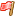

<!-- Archived from wiki.surfguitar101.com (MoinMoin), page "Sg101Faq", revision 10.
     Lossless original: archive/wiki/moinmoin/Sg101Faq/revisions/00000010 -->

# SurfGuitar101.com Frequently Asked Questions

## I registered but I never received the confirmation email

Normally the confirmation email should arrive within minutes. If you do not receive the email after a short period, please check any spam folders first. If this fails you can try to register one more time as sometimes a typo is made in the email address. Failing all that, please [contact us](http://surfguitar101.com/contact/) for help.

## I can't remember my password

You can reset your password [here](http://surfguitar101.com/accounts/password/reset/). If you still have trouble, please [contact us](http://surfguitar101.com/contact/). Please provide your best guess at your username and the email address you registered with.

## I'm having trouble logging in

The most common mistake is trying to use your email address to login. You have to use the username you picked when you registered. If you continue to have trouble, please [contact us](http://surfguitar101.com/contact/) for help.

## I tried too many times to login and now I'm locked out

For security reasons we put a limit on the rate of login attempts. If you enter an incorrect password too many times in a short period, your account may be locked out. Simply wait about 10 minutes before trying again. We're sorry for the inconvenience. We're trying to prevent password guessing.

## Hey can you add my band to your band map?

Please add the information yourself using the [form here](http://surfguitar101.com/bandmap/add/). Also, **please please please** be as specific as you can with the location information. If 10 bands all submit entries with the location "Chicago, Illinois" for example, all 10 band markers will stack up on each other and be hard to see on the map. You probably don't want to add your exact home address for privacy reasons, but please pick a local landmark, favorite club or recording studio address instead.

## How do I edit my forum post?

To edit a forum post you made, click the "edit post icon" (which looks like this: ) located in the bottom right of your post.

## How do I change a forum thread title?

To change a thread title, edit the first post in the thread (see above).

## How do I delete a forum post I made?

Currently you can't do this. Please edit the post (see above) to read "delete me" and then click the red flag icon ( located in the bottom right of your post) to notify the moderators.

## How do I post a photo in the forums?

See [/PostingPhotos](Sg101Faq/PostingPhotos.md).

## How do I chat in the chat room (IRC)?

See [/IrcChat](Sg101Faq/IrcChat.md)

## How do I change my username?

This can only be done by an admin, please [contact us](http://surfguitar101.com/contact/) for assistance. **This should only be done very rarely, if at all**. Please note that this is much preferable to creating a new account, as all your forum posts, badges, and comments will follow your new username. Creating a new account starts you over at zero, and you'll have to build up trust within the community again. Creating a new account also clutters up the database and you run the risk of using two accounts at the same time, which is in violation of the site rules.

## Can I advertise on SurfGuitar101.com?

No, we currently do not accept advertising. Thanks for your interest.
